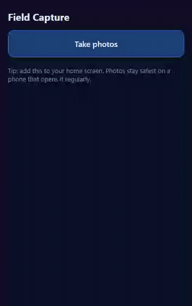

# GHL Tenant Bridge

[](https://github.com/Exalt24/ghl-tenant-bridge/actions/workflows/ci.yml)



*One unedited recording: the signal drops, four photos queue locally, then the queue drains to empty on its own.*

Multi-tenant GoHighLevel to Supabase bridge with PostGIS storm matching and an offline photo capture queue. It also does keyless geocoding and county parcel lookup.

Built by driving the real APIs rather than reading about them. **Measured numbers were measured on this machine. Browser and iOS facts are cited from vendor docs. Unimplemented things are listed as gaps.**

- **12 test suites that print a count, 323 counted assertions in all.** They run against a real Postgres, a real browser and live third-party APIs. The published-keys diff and the live tenant isolation check report pass or fail. The edge worker has its own tests. The per-suite counts are listed under Tests.
- The suites that touch a live service run a **positive control before the negative test**. A broken request cannot pass for a successful refusal.
- **Register, stated plainly:** the database and storage are a real hosted Supabase project. The Next.js app runs locally. So this is "built, tested, and running against a real hosted backend".

---

## The offline queue, actually working

A roofer stands on a roof with no signal. He takes four photos and drives away. Nothing may be lost. Nothing may be sent twice.

The recording at the top shows the signal dropping and four photos queueing on the device. When the signal returns, the queue drains to empty on its own. `tests/offline-drain.e2e.mjs` asserts that the server received nothing while offline, then checks the server's own counter after the drain.

Screenshots, the test output and the design reasoning are in [docs/offline-queue.md](docs/offline-queue.md).

---

## The finding worth reading first

**HighLevel announced that the legacy `X-WH-Signature` webhook header is deprecated on 2026-09-01.** From
that date webhooks are signed only with `X-GHL-Signature` (Ed25519). Any integration
verifying just the legacy RSA header stops validating then (announced by the vendor, not observed here).

This bridge is dual-path and prefers Ed25519. It **fails closed** on a legacy signature presented after the sunset. `GET /api/webhooks/ghl` reports `daysUntilLegacySunset`. The cutover is an ops number rather than a memory.

Source: [HighLevel Webhook Integration Guide](https://marketplace.gohighlevel.com/docs/webhook/WebhookIntegrationGuide/)

---

## What is in here

| Path | What it is |
|---|---|
| `src/app/capture/page.tsx` | The field capture surface. Downscales, stamps GPS at capture, queues locally. |
| `src/lib/outbox.ts` | The queue. UUIDv7 keys minted at capture, single-flight flush, proof-of-write guard. |
| `src/lib/outbox-storage-browser.ts` | OPFS for bytes, IndexedDB for metadata, with a fallback because Safari lacked `createWritable` until 26. |
| `src/lib/outbox-runtime.ts` | Registers the flush triggers, page-driven because iOS has no background path. |
| `src/lib/outbox-transport-*.ts` | The Supabase transport (row count from a PostgREST `.select()`) and a reference HTTP one. |
| `supabase/migrations/0002_postgis.sql` | Spherical storm-to-property matching. Generated geography columns, GiST, `SECURITY INVOKER` so RLS applies. |
| `supabase/migrations/0005_farm_lists.sql` | Farm lists of GPS points and polygons: every plot gets a status and a reason code, and `plot_overlaps` gives hectares and percent against a reference layer on geography. See [Farm lists](#farm-lists). |
| `src/lib/geocode.ts` | US Census geocoding, keyless. Honest that it returns a block-face interpolation, not a rooftop. |
| `src/lib/parcels.ts` | County ArcGIS parcel lookup. Envelope-only, because a point query silently matches nothing. |
| `src/lib/ghl-signature.ts` | Dual Ed25519 / legacy-RSA verification, sunset-aware, fails closed. |
| `src/lib/ghl-oauth.ts` | OAuth install, rotating refresh, agency-to-location exchange. Proven live. |
| `src/lib/noaa.ts` / `src/lib/swdi.ts` | Live NWS alerts and historical hail via NCEI SWDI, both keyless. |
| `src/app/api/webhooks/ghl/route.ts` | The receiver: verify, replay window, tenant resolve, idempotency, apply, dead-letter. |
| `edge/` | A Cloudflare Worker that verifies GHL's Ed25519 signature, stores each delivery once in D1 and forwards it on a cron with backoff. Its own tests, including real workerd. See [edge/README.md](edge/README.md). |
| `relay/` | A Python and Flask relay: takes a GoHighLevel lead delivery and fans it out to Slack, a Make webhook, Meta Conversions API and Google Sheets, at least once, with a stored outcome per sink, on SQLite or Postgres. It also pulls ad spend from Meta Insights and Windsor.ai, receives Fathom webhooks and reconciles a payments CSV. Built against the vendors' documented contracts and tested with local stand-in servers written from their saved pages, plus one check of the Google Sheets calls with my own sign-in. See [relay/README.md](relay/README.md) and the runnable [cutover demo](relay/docs/demo.md). |
| `infra/` | Terraform for the relay on AWS Fargate and RDS Postgres. Checked with an offline plan, 28 guard test runs and 49 mutants. See [infra/README.md](infra/README.md). |
| `graphql/` | Hasura GraphQL Engine over the PostGIS schema, with a per-organisation permission rule and a smoke test against real containers. See [graphql/README.md](graphql/README.md). |
| `docs/` | `INTEGRATION_CONTRACT.md` and `DEMO_PORTABILITY.md`. |

---

## Measured facts

The numbers here were measured on this machine. The exceptions are browser and iOS facts cited from vendor docs. The full list is in [docs/MEASURED_FACTS.md](docs/MEASURED_FACTS.md). It has the geocoding, parcel, browser and HighLevel findings.

---

## Tests

```bash
sh tests/run_all.sh               # everything

node tests/signature.test.mjs      # 19  real crypto, both directions
node tests/workflow-auth.test.mjs  # 22  constant-time, downgrade guard
node tests/noaa.test.mjs           # 17  live NWS API
node tests/swdi.test.mjs           # 23  live SWDI, bbox proven both ways
node tests/geo.test.mjs            # 31  live Census + live county parcels
node tests/outbox.test.mjs         # 56  state machine, all deps injected
node tests/outbox.browser.mjs      # 33  real Chromium, survives a reload
node tests/offline-drain.e2e.mjs   # 9   capture offline, reconnect, queue empties
python tests/postgis.test.py        # 25  real migrations on real Postgres
python tests/farm_lists.test.py     # 61  farm-list intake on real PostGIS

(cd edge && npm install && npm run test:all)   # 43 + 28 mutants + 14 in real workerd
python tests/verify_public_keys.py  #     shipped keys == HighLevel's published keys
python tests/tenant_isolation.py    #     live GHL cross-tenant isolation, with a control
python tests/verify_oauth_claims.py # 17  decodes the JWTs, re-runs isolation
node tests/hosted-supabase.e2e.mjs # 10  the SHIPPING transport vs hosted Supabase
```

Eight suites skip loudly on a fresh clone. `tenant_isolation.py` is opt-in. It makes live calls to a HighLevel test environment, so it runs only when `GHL_SANDBOX_PIT_FILE` names a token file. `verify_public_keys.py` runs against `tests/fixtures_ghl_published_keys.json`. `GHL_PUBLISHED_KEYS_JSON` points it elsewhere. `verify_oauth_claims.py` needs gitignored token files. It gives a loud SKIP once the saved token has expired, about a day. `postgis.test.py` and `farm_lists.test.py` need a local `pgis` container. `hosted-supabase.e2e.mjs` needs the hosted project's settings. `outbox.browser.mjs` needs Playwright at a fixed global npm path, to change on another machine. `offline-drain.e2e.mjs` needs Playwright the same way, plus `next start -p 3111`.

The counts above are what each suite prints. On 2026-10-07 I re-ran nine of them from a fresh clone. All passed with the printed counts, about 235 assertions by the counts they print. No log was kept, so treat that as a recollection. The rest need the gitignored token files and the hosted Supabase project.

**A green test proves nothing until it has been watched go red for the right reason.**
Reverting the coordinate order in `0002_postgis.sql` produced 5 failures. They included the 40 km property collapsing to 4.75 km (checked once, not a saved mutant).

Some tests exist because of a specific mistake:

- `verify_public_keys.py` exists because the RSA key body was **fabricated** in a first draft. A wrong public key does not crash. It silently fails every verification. So the shipped artifact is diffed against the scraped published key.
- `tenant_isolation.py` runs a **positive control first**. Tenant A writes and reads back its own contact. That proves the harness works. Only then is tenant B refused. Without it, a broken request would "prove" isolation by failing for the wrong reason.
- `outbox.browser.mjs` **forces the IndexedDB backend**. Chromium supports `createWritable` and would otherwise leave that whole path unexecuted. That is the path most iPhones will actually use.

---

## Running it

```bash
npm install
cp .env.example .env.local          # then fill in

# Supabase, or Postgres 17 with PostGIS plus tests/supabase_shim.sql (auth.uid()); apply 0001 to 0005 in order
psql "$SUPABASE_DB_URL" -f supabase/migrations/0001_schema.sql
psql "$SUPABASE_DB_URL" -f supabase/migrations/0002_postgis.sql
psql "$SUPABASE_DB_URL" -f supabase/migrations/0003_field_captures.sql   # then 0004_storage_field_photos.sql (needs Supabase's storage schema) and 0005_farm_lists.sql

npm run build
DEMO_SINK=1 npm start               # http://localhost:3000/capture
```

Required env: `NEXT_PUBLIC_SUPABASE_URL`, `NEXT_PUBLIC_SUPABASE_ANON_KEY`,
`SUPABASE_SERVICE_ROLE_KEY`, and `NWS_USER_AGENT` (NWS returns **403** on an empty
User-Agent, measured).

`DEMO_SINK=1` enables `/api/demo/queue`. It is a local no-op sink, so the queue can drain without Supabase credentials. It refuses to run in production unless explicitly set. That keeps it from becoming an accidental open upload endpoint. With Supabase configured, swap the capture page's transport for `createSupabaseOutboxTransport`.

### Local Postgres for the PostGIS suite

```bash
docker run --rm -d --name pgis -e POSTGRES_PASSWORD=pw -p 55432:5432 postgis/postgis:17-3.5
python tests/postgis.test.py
```

`tests/supabase_shim.sql` stands in for the `auth` schema and Supabase's default privileges. That lets RLS be **exercised** locally. It is a test harness and says so. It validates policy logic, not Supabase's permission model.

### The shim is no longer the last word

Why the PostGIS suite ran on a shim first and what replaced it: [docs/SUPABASE_SHIM.md](docs/SUPABASE_SHIM.md).

---

## Farm lists

`supabase/migrations/0005_farm_lists.sql` validates a customer's GeoJSON of GPS points and polygons. Each plot gets a status and a reason code. `plot_overlaps` reports hectares and percent of overlap with a reference layer on geography. A bow-tie ring is rejected, not repaired. Two squares that only share an edge are not an overlap. Measured on 2026-10-24: 61 checks on real PostGIS and 17 of 17 guards caught by the mutation check. Sample data only, nothing deployed. The decisions, reason codes and limits are in [docs/farm-lists.md](docs/farm-lists.md).

## Scope and next steps

- **Runs locally.** The Next.js app runs on a local machine against the hosted Supabase project.
- **iOS is documentation, not measurement.** The browser suite is Chromium on Windows. It proves the adapter is correct against the standard APIs. The seven-day eviction and the smaller iOS quota are cited from WebKit's own docs. They have not been reproduced on a device here.
- **Webhook subscription registration is UI-only** on both paths, by the vendor's design. Both paths are handled in code. Neither can be created via API.
- **No live authenticated write to a customer's production account.** The sandbox work is real. A production write is not claimed.
- **The workflow path is unsigned** and cannot be made otherwise. Prefer Marketplace app
  webhooks, which are free, signed, retried and logged.
- **Roof geometry is not solved here.** Ridge, hip and valley measurement has no free and legal source.
- **Google imagery is off-limits** for this shape of product. Its terms forbid tracing or digitising building outlines. They forbid training models on it. They forbid mixing it with a non-Google basemap.

---

## Free vs paid, and why it matters for reuse

What is free and permanent and what expires or costs money: [docs/FREE_VS_PAID.md](docs/FREE_VS_PAID.md).

