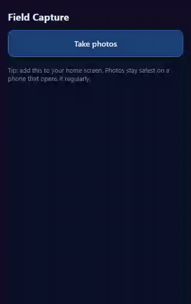
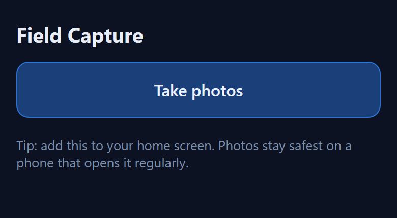
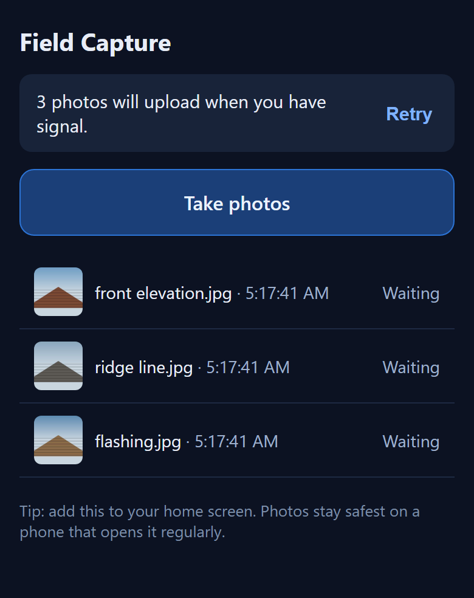
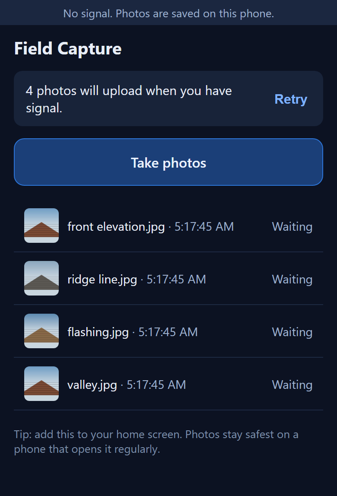
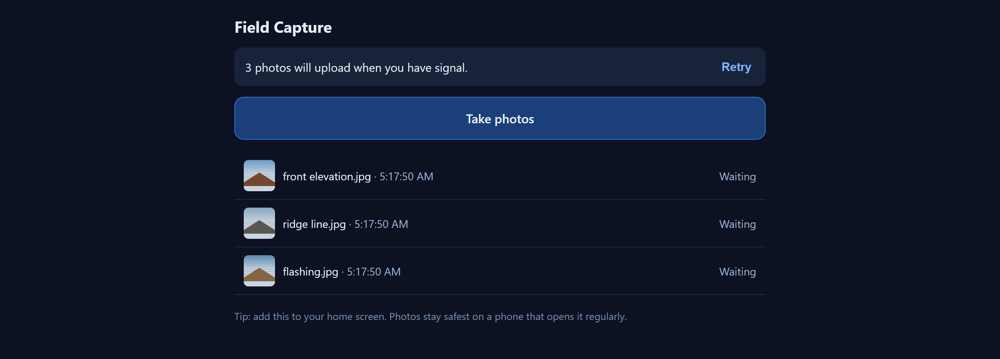

# GHL Tenant Bridge

[](https://github.com/Exalt24/ghl-tenant-bridge/actions/workflows/ci.yml)



*One unedited recording: the signal drops, four photos queue locally, then the queue drains to empty on its own.*

Multi-tenant GoHighLevel to Supabase bridge with PostGIS storm matching and an offline photo capture queue. It also does keyless geocoding and county parcel lookup.

Built by driving the real APIs rather than reading about them. **Measured numbers were measured on
this machine; browser and iOS facts are cited from vendor docs. Unimplemented things are listed as gaps.**

- **12 test suites that print a count, 324 counted assertions in all** (the
  published-keys diff and the live tenant isolation check report pass or fail, and the
  edge worker has its own tests), run against a real Postgres, a real browser and live third-party APIs. The
  per-suite counts are listed under Tests.
- The suites that touch a live service run a **positive control before the negative
  test**, so a broken request cannot pass for a successful refusal.
- **Register, stated plainly:** the database and storage are a real hosted Supabase
  project, and the Next.js app is run locally. Nothing is deployed to a public URL
  and there are no real users, so this is "built, tested, and running against a real
  hosted backend", never "in production".

---

## The offline queue, actually working

A roofer stands on a roof with no signal, takes four photos, and drives away. Nothing
may be lost, and nothing may be sent twice.

In the recording at the top, left to right: signal drops and the strip appears,
four photos queue locally while the count climbs, then signal returns and the queue
drains to empty on its own. The server received nothing during the offline stretch.

`tests/offline-drain.e2e.mjs` asserts exactly that, and checks the server's own counter
afterwards so "the queue emptied" cannot pass by the client simply forgetting:

```
PASS  offline strip shows when the connection drops
PASS  four photos captured with NO connection
PASS  all four are in the queue
PASS  the server received NOTHING while offline
PASS  the queue drained to empty after reconnecting
PASS  the server actually received the uploads      (abridged)
PASS  no orphaned photo bytes left on the device
```

| | |
|---|---|
|  |  |
| Nothing queued, so nothing is said. The quiet state is the absence of a badge, not a green tick. | Count plus action. Thumbnails are read back from device storage, so they survive a reload. |

### The state that matters



No signal, four photos held on the device, each one named and marked *Waiting*. The
strip is deliberately quiet: a thin line of muted text, not a red banner, because the
app is working exactly as intended and saying so loudly would be a lie about severity.

The same page at desktop width, since a field tool still gets opened on a laptop in an
office:



### Why the interface looks like this

The design came from reading real field apps, not from taste. **CompanyCam's actual
mobile UI** is a thin muted strip reading "You seem to be offline." and a calm grey card
reading "3 items waiting to upload." with a one-word action. The first draft here was a
red alert bar, which is precisely the documented **Housecall Pro** failure whose
persistent "OFFLINE Limited Functionality" banner false-fires on good signal and draws
review complaints.

So: **count plus action, never status plus colour**, and the card disappears at zero
(Encircle's decrementing-badge pattern). The copy says what will happen, because
web.dev's guidance is that non-technical audiences misread the word "offline".

Two more borrowed decisions. **Capture never blocks on a save**, because Encircle earned a
3-star review for making users save one picture before taking the next. And **GPS and
time are stamped at capture, not at upload**, because the upload can be hours later.

Accessibility was checked against the spec rather than assumed. `role="status"` carries
an implicit `aria-live="polite"` and `aria-atomic="true"`, and MDN documents it as
**inappropriate for a frequently-updating counter**, since every photo would fire a full
announcement. So the count is plain text and one polite region announces transitions
only. The queue is a plain list with real buttons, never a listbox holding buttons.

---

## The finding worth reading first

**HighLevel announced that the legacy `X-WH-Signature` webhook header is deprecated on 2026-09-01.** From
that date webhooks are signed only with `X-GHL-Signature` (Ed25519). Any integration
verifying just the legacy RSA header stops validating then (announced by the vendor, not observed here).

This bridge is dual-path, prefers Ed25519, and **fails closed** on a legacy signature
presented after the sunset. `GET /api/webhooks/ghl` reports `daysUntilLegacySunset` so
the cutover is an ops number rather than a memory.

Source: [HighLevel Webhook Integration Guide](https://marketplace.gohighlevel.com/docs/webhook/WebhookIntegrationGuide/)

---

## What is in here

| Path | What it is |
|---|---|
| `src/app/capture/page.tsx` | The field capture surface. Downscales, stamps GPS at capture, queues locally. |
| `src/lib/outbox.ts` | The queue. UUIDv7 keys minted at capture, single-flight flush, proof-of-write guard. |
| `src/lib/outbox-storage-browser.ts` | OPFS for bytes, IndexedDB for metadata, with a fallback because Safari lacked `createWritable` until 26. |
| `src/lib/outbox-runtime.ts` | Registers the flush triggers, page-driven because iOS has no background path. |
| `src/lib/outbox-transport-*.ts` | The Supabase transport (row count from a PostgREST `.select()`) and a reference HTTP one. |
| `supabase/migrations/0002_postgis.sql` | Spherical storm-to-property matching. Generated geography columns, GiST, `SECURITY INVOKER` so RLS applies. |
| `supabase/migrations/0005_farm_lists.sql` | Farm lists of GPS points and polygons: every plot gets a status and a reason code, and `plot_overlaps` gives hectares and percent against a reference layer on geography. See [Farm lists](#farm-lists). |
| `src/lib/geocode.ts` | US Census geocoding, keyless. Honest that it returns a block-face interpolation, not a rooftop. |
| `src/lib/parcels.ts` | County ArcGIS parcel lookup. Envelope-only, because a point query silently matches nothing. |
| `src/lib/ghl-signature.ts` | Dual Ed25519 / legacy-RSA verification, sunset-aware, fails closed. |
| `src/lib/ghl-oauth.ts` | OAuth install, rotating refresh, agency-to-location exchange. Proven live. |
| `src/lib/noaa.ts` / `src/lib/swdi.ts` | Live NWS alerts and historical hail via NCEI SWDI, both keyless. |
| `src/app/api/webhooks/ghl/route.ts` | The receiver: verify, replay window, tenant resolve, idempotency, apply, dead-letter. |
| `edge/` | A Cloudflare Worker that verifies GHL's Ed25519 signature, stores each delivery once in D1 and forwards it on a cron with backoff. Its own tests, including real workerd. See [edge/README.md](edge/README.md). |
| `relay/` | A Python and Flask relay: takes a GoHighLevel lead delivery and fans it out to Slack, a Make webhook, Meta Conversions API and Google Sheets, at least once, with a stored outcome per sink, on SQLite or Postgres. It also pulls ad spend from Meta Insights and Windsor.ai, receives Fathom webhooks and reconciles a payments CSV. Built against the vendors' documented contracts and tested with local fakes, no vendor account was used except one check of the Google Sheets calls with my own sign-in, and it is not deployed.. See [relay/README.md](relay/README.md) and the runnable [cutover demo](relay/docs/demo.md). |
| `infra/` | Terraform for the relay on AWS Fargate and RDS Postgres. Offline plan, 28 guard test runs and 49 mutants, never applied. See [infra/README.md](infra/README.md). |
| `graphql/` | Hasura GraphQL Engine over the PostGIS schema, with a per-organisation permission rule and a smoke test against real containers. See [graphql/README.md](graphql/README.md). |
| `docs/` | `INTEGRATION_CONTRACT.md` and `DEMO_PORTABILITY.md`. |

---

## Measured facts

The numbers here were measured on this machine, except browser and iOS facts cited from vendor docs; the full list, with the geocoding, parcel, browser and HighLevel findings, is in [docs/MEASURED_FACTS.md](docs/MEASURED_FACTS.md).

---

## Tests

```bash
sh tests/run_all.sh               # everything

node tests/signature.test.mjs      # 19  real crypto, both directions
node tests/workflow-auth.test.mjs  # 22  constant-time, downgrade guard
node tests/noaa.test.mjs           # 17  live NWS API
node tests/swdi.test.mjs           # 23  live SWDI, bbox proven both ways
node tests/geo.test.mjs            # 31  live Census + live county parcels
node tests/outbox.test.mjs         # 56  state machine, all deps injected
node tests/outbox.browser.mjs      # 33  real Chromium, survives a reload
node tests/offline-drain.e2e.mjs   # 9   capture offline, reconnect, queue empties
python tests/postgis.test.py        # 25  real migrations on real Postgres
python tests/farm_lists.test.py     # 61  farm-list intake on real PostGIS

(cd edge && npm install && npm run test:all)   # 42 + 28 mutants + 14 in real workerd
python tests/verify_public_keys.py  #     shipped keys == HighLevel's published keys
python tests/tenant_isolation.py    #     live GHL cross-tenant isolation, with a control
python tests/verify_oauth_claims.py # 17  decodes the JWTs, re-runs isolation
node tests/hosted-supabase.e2e.mjs # 10  the SHIPPING transport vs hosted Supabase
```

Six suites skip loudly on a fresh clone: `verify_oauth_claims.py` (gitignored token files), `postgis.test.py` and
`farm_lists.test.py` (a local `pgis` container), `hosted-supabase.e2e.mjs` (the hosted project's settings),
`outbox.browser.mjs` (Playwright at a fixed global npm path, to change on another machine) and
`offline-drain.e2e.mjs` (Playwright the same way, plus `next start -p 3111`).

The counts above are what each suite prints. On 2026-10-07 I re-ran nine of them from a
fresh clone and all passed with the printed counts (236 assertions in all; log not kept). The rest
need the gitignored token files and the hosted Supabase project.

**A green test proves nothing until it has been watched go red for the right reason.**
Reverting the coordinate order in `0002_postgis.sql` produced 5 failures, including the
40 km property collapsing to 4.75 km (checked once, not a saved mutant).

Some tests exist because of a specific mistake:

- `verify_public_keys.py` exists because the RSA key body was **fabricated** in a first
  draft. A wrong public key does not crash; it silently fails every verification, so
  the shipped artifact is diffed against the scraped published key.
- `tenant_isolation.py` runs a **positive control first**: tenant A writes and reads
  back its own contact, proving the harness works, and only then is tenant B refused.
  Without it, a broken request would "prove" isolation by failing for the wrong reason.
- `outbox.browser.mjs` **forces the IndexedDB backend**, because Chromium supports
  `createWritable` and would otherwise leave that whole path unexecuted, and that is
  the path most iPhones will actually use.

---

## Running it

```bash
npm install
cp .env.example .env.local          # then fill in

# Supabase, or Postgres 17 with PostGIS plus tests/supabase_shim.sql (auth.uid()); apply 0001 to 0005 in order
psql "$SUPABASE_DB_URL" -f supabase/migrations/0001_schema.sql
psql "$SUPABASE_DB_URL" -f supabase/migrations/0002_postgis.sql

npm run build
DEMO_SINK=1 npm start               # http://localhost:3000/capture
```

Required env: `NEXT_PUBLIC_SUPABASE_URL`, `NEXT_PUBLIC_SUPABASE_ANON_KEY`,
`SUPABASE_SERVICE_ROLE_KEY`, and `NWS_USER_AGENT` (NWS returns **403** on an empty
User-Agent, measured).

`DEMO_SINK=1` enables `/api/demo/queue`, a local no-op sink so the queue can drain
without Supabase credentials. It refuses to run in production unless explicitly set, so
it cannot become an accidental open upload endpoint. With Supabase configured, swap the
capture page's transport for `createSupabaseOutboxTransport`.

### Local Postgres for the PostGIS suite

```bash
docker run --rm -d --name pgis -e POSTGRES_PASSWORD=pw -p 55432:5432 postgis/postgis:17-3.5
python tests/postgis.test.py
```

`tests/supabase_shim.sql` stands in for the `auth` schema and Supabase's default
privileges so RLS can be **exercised** locally. It is a test harness and says so; it
validates policy logic, not Supabase's permission model.

### The shim is no longer the last word

Why the PostGIS suite ran on a shim first and what replaced it: [docs/SUPABASE_SHIM.md](docs/SUPABASE_SHIM.md).

---

## Farm lists

`supabase/migrations/0005_farm_lists.sql` validates a customer's GeoJSON of GPS points and polygons into a status and a reason code per plot, and `plot_overlaps` reports hectares and percent of overlap with a reference layer on geography. A bow-tie ring is rejected, not repaired, and two squares that only share an edge are not an overlap. Measured on 2026-10-24: 61 checks on real PostGIS and 17 of 17 guards caught by the mutation check. Sample data only, nothing deployed. The decisions, reason codes and limits are in [docs/farm-lists.md](docs/farm-lists.md).

## Known gaps


- **Not deployed.** It runs locally. No hosted instance, no users.
- **iOS is documentation, not measurement.** The browser suite is Chromium on Windows.
  It proves the adapter is correct against the standard APIs; the seven-day eviction and
  the smaller iOS quota are cited from WebKit's own docs and have not been reproduced on
  a device here.
- **Webhook subscription registration is UI-only** on both paths, by the vendor's
  design. Both paths are handled in code; neither can be created via API.
- **No live authenticated write to a customer's production account.** The sandbox work
  is real; a production write is not claimed.
- **The workflow path is unsigned** and cannot be made otherwise. Prefer Marketplace app
  webhooks, which are free, signed, retried and logged.
- **Roof geometry is not solved here.** Ridge, hip and valley measurement has no free and legal source.
- **Google imagery is off-limits** for this shape of product: its terms forbid tracing
  or digitising building outlines, forbid training models on it, and forbid mixing it
  with a non-Google basemap.

---

## Free vs paid, and why it matters for reuse

What is free and permanent and what expires or costs money: [docs/FREE_VS_PAID.md](docs/FREE_VS_PAID.md).

