# Lead welcome workflow: HighLevel form, workflow and a Make.com scenario

A lead fills in a HighLevel form. They get a tag, a welcome email and a row in a Google Sheet. If they do not open the email within 48 hours, the team gets a follow-up task. This page is how that was built and run on 2026-11-09 and 2026-11-10, with the parts that did not work as planned stated where they happened.

Everything ran in the free HighLevel developer sandbox (sub-account `ASC Test Tenant B`) and on the free Make.com plan. Every contact is invented. Nothing here is a client system.

## What lives where

| Piece | Lives in | Why |
|---|---|---|
| Form, tag, welcome email, wait and the follow-up task | HighLevel | These act on the contact and the conversation, so they belong next to the CRM record. |
| Row in a Google Sheet, tag split, no email handling, retries | Make.com | HighLevel has no row-per-event log, and Make gives routers, an iterator and an error handler. |
| The link between them | One POST from a HighLevel Webhook action to a Make Custom Webhook | HighLevel sends the contact in its standard payload, Make reads it. |

## Build order

1. **Sheet.** A Google Sheet named `Lead log (test)` with three tabs: `Leads` (received_at, first_name, last_name, email, phone, tags), `Lead tags` (received_at, email, tag) and `No email` (received_at, first_name, phone, reason).
2. **Make webhook.** A Custom Webhook called `Lead intake hook`. Its URL goes into the HighLevel Webhook action. The URL is a secret and is not in this repo.
3. **Make scenario `Lead welcome log`** (exported blueprint: [lead-welcome-log.blueprint.json](lead-welcome-log.blueprint.json), connection, sheet and webhook ids replaced with placeholders):
   - Custom Webhook trigger.
   - Router with two routes. Route 1 has the filter `email exists`. Route 2 has the filter `email does not exist`.
   - Route 1: Google Sheets Add a Row into `Leads`, then an Iterator over `split(tags; ",")` (Make's split trims each piece), then Add a Row into `Lead tags`, one row per tag.
   - Route 2: Add a Row into `No email` with the reason, so a lead without an email is logged and not dropped.
   - An error handler on the `Leads` module: Retry (Make's Break directive) with 3 automatic retries 15 minutes apart. Scenario setting `Store incomplete executions` is on, which Break needs.
   - Scenario turned on, scheduled "immediately as data arrives".
4. **HighLevel form** `Lead intake (test)`: first name, last name, phone (required), email (required). The form is reachable through the published link.
5. **HighLevel workflow** `Lead welcome and 48h follow-up`, trigger Form submitted with the filter `Form is Lead intake (test)`:
   1. Add contact tag `new-lead`.
   2. Send email (subject `Thanks for reaching out, {{contact.first_name}}`, a three sentence plain body).
   3. Webhook action, POST to the Make URL.
   4. Wait until the contact takes an action: Email event, Opened, for the Welcome email step, with a timeout of 48 hours.
   5. The wait has two outputs. `Email event` (opened) ends. `Time out` runs Add task `Follow up: welcome email not opened`, assigned to a team member, due the next day at 1 PM.
6. Publish the workflow.

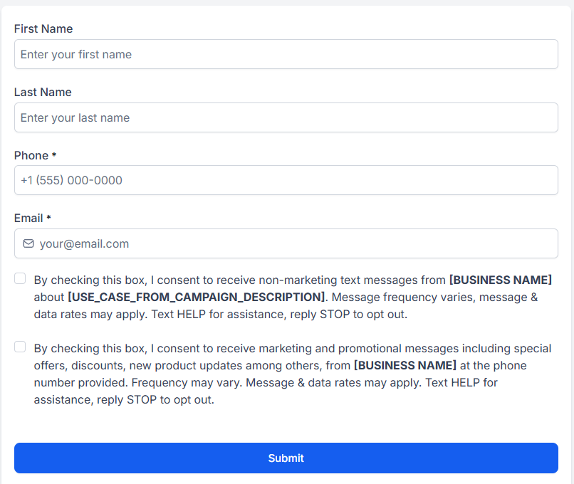

*The form as built in the HighLevel form builder.*

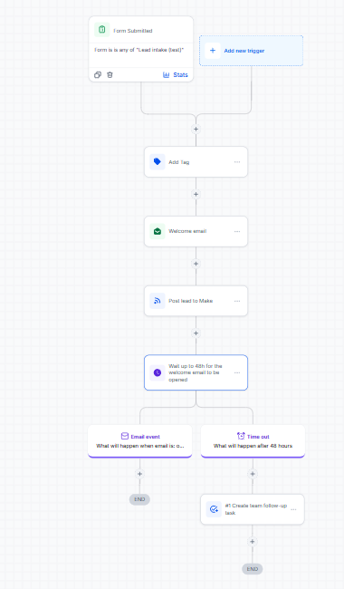

*Trigger, tag, welcome email, webhook to Make and the wait.*

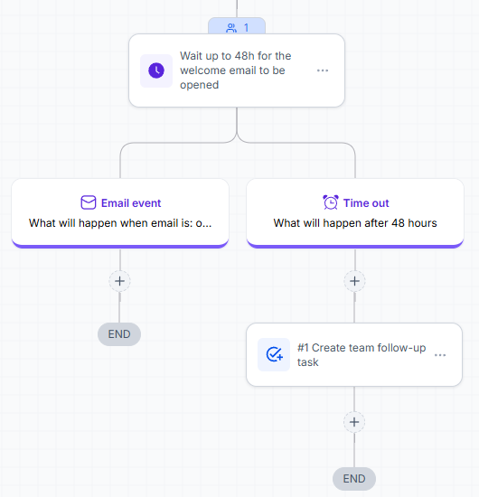

*The wait with its two outputs. The badge on top says one contact is waiting there right now.*

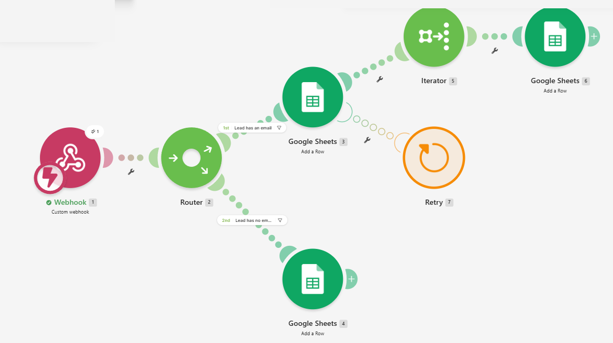

*The Make scenario: webhook, router with two filtered routes, an iterator for the tags, and the Retry error handler on the Leads module.*

## Design choices worth knowing

- **The 48 hour check is one wait step, not a wait followed by an If/Else.** The If/Else condition list has no "email opened" field (a search for `open` returned nothing). HighLevel's own wait step can wait for an email event with a timeout, and it has an opened output and a timeout output. That is what is built.
- **The Webhook action, not Custom Webhook.** HighLevel marks Custom Webhook as a premium action with a charge per execution, so the plain Webhook action is used. It sends the contact's standard fields (contact id, names, email, phone, a comma separated `tags` string, the form as the source).
- **Make stores the HighLevel creation time, not "now".** A formula typed as `formatDate(now; ...)` failed (see "What went wrong" below), so column A is the `date_created` HighLevel sends.
- **No authentication on the Make webhook in this test.** A production build would add Make's API key header on the webhook and set it in the HighLevel Webhook action headers.

## What was run

| Step | Result | Evidence |
|---|---|---|
| Form submitted from the published link, invented lead with phone `+1 512 555 0143` | Contact created, workflow started | execution log below |
| Tag `new-lead` | Contact read back through the API: `tags: ["new-lead"]` | execution log, API read |
| Welcome email step | **Ran, but HighLevel refused to send it** (see below) | screenshot below |
| Webhook to Make | Delivered. Make received the full contact in its first manual run, then in every live run | Make history |
| Row in the Sheet | Read back with the Sheets API: `Priya Testlead` row in `Leads` and `new-lead` in `Lead tags` | screenshots below |
| Wait up to 48 hours | Contact sits at the wait step: the workflow list shows 1 active enrolled and the step badge shows 1 waiting | screenshots below |
| Not opened branch | Run on a temporary copy with a 1 minute timeout, not on the 48 hour original | see "The not opened branch" |

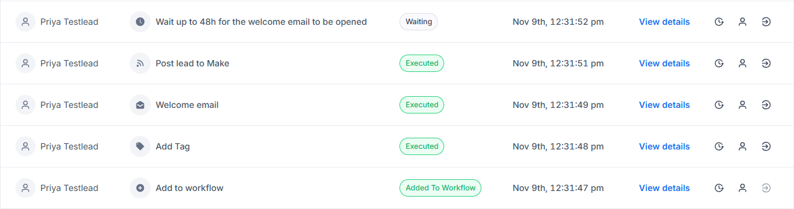

*Execution log of the live workflow for the invented contact: added to workflow, tag, welcome email, post to Make, then waiting at the wait step.*

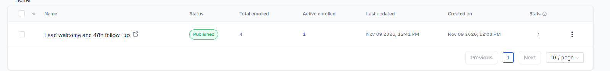

*The workflows list: one active enrollment, the contact waiting at the 48 hour step.*

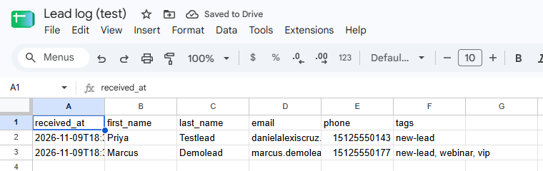

*The `Leads` tab. Row 2 came from a real HighLevel submission. Row 3 is a direct test post that mimics HighLevel's payload with three tags.*

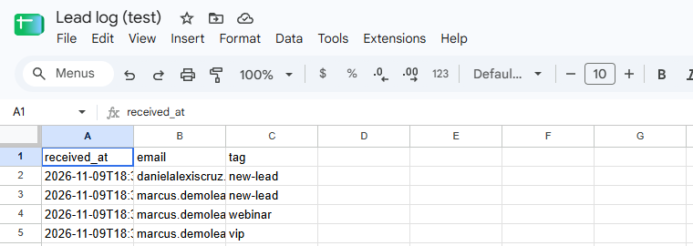

*The iterator turned the three tags of the test post into three rows. The `new-lead` row at the top is the HighLevel lead.*

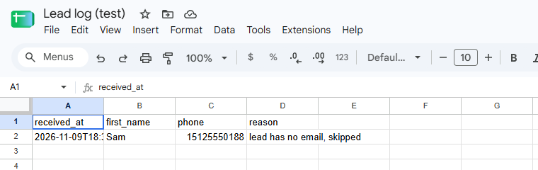

*A direct test post with an empty email went down the second route and was logged here instead of the `Leads` tab.*

### Not run through HighLevel

Two Sheet checks used a direct POST to the Make webhook shaped like HighLevel's payload, because the HighLevel form requires an email: the multi-tag lead (`marcus.demolead@example.com`) and the lead without an email. They prove the Make side, not the HighLevel side.

## What went wrong, and what it shows

**HighLevel blocks email from a sandbox.** The Send email step reports "Email queued successfully", and the execution detail then shows the email as Failed. The conversation message read through the API carries the reason: `Email sending is blocked for sandbox agencies`. So no welcome email reached an inbox, and no email can be opened, in this sandbox. The step, its merge fields and the wiring are built and ran; the delivery is a platform limit that a real sub-account would not have.

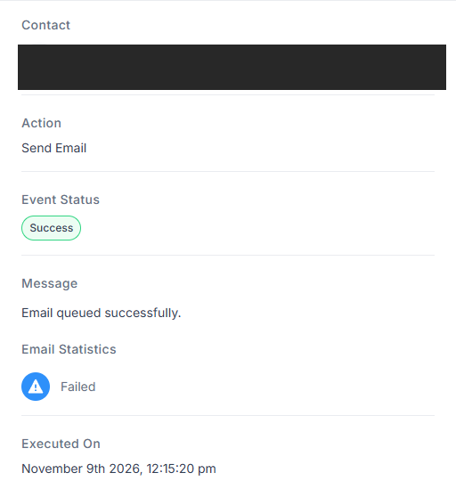

*The step is queued and then Failed. The contact block is hidden.*

**The Make error handler caught a real error.** The first live run failed in the `Leads` module: `Failed to map 'values.0': Function 'formatDate' finished with error! 'now' is not a valid date.` The Retry handler caught it, the run finished with a warning instead of failing silently, and the lead was stored as an incomplete execution, scheduled to retry in about 15 minutes. Retrying it by hand re-ran the old module settings and failed again, so it shows as Unresolved. That is how Make behaves: a stored execution keeps the configuration it failed with. The fix (use `date_created`) applied to new leads.

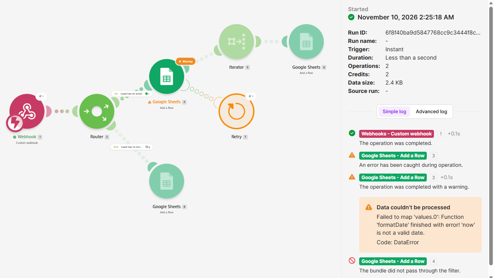

*The failed mapping, caught by Retry.*

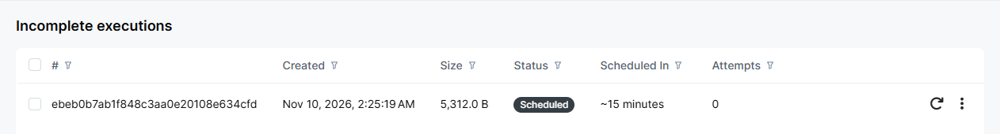

*The lead kept as an incomplete execution, with its retry schedule.*

**Typed variable references inside a Make function are not resolved.** `trim(5.value)` and `split(1.tags; ",")` typed by hand produced literal text in the Sheet. Inserting the variables from the mapping panel (and using the iterator's own `Value`) fixed it. Split already trims, so `trim` was not needed.

**The follow-up task was skipped the first time.** `Task cannot be created with both assigned to contact's assigned user or custom assigned user`. The sandbox sub-account had no team member, so the Assign to list was empty. One user (`Team Member Test`) was created through the users API, assigned, and the task then ran.

**The phone number lost its plus sign in the Sheet.** The rows are written as USER_ENTERED, so Sheets read `+15125550143` as a number. Setting the module's Unformatted option to Yes keeps it as text; that was not changed.

**Re-entry.** A contact who submits again while still waiting in the workflow is skipped by HighLevel ("Add to workflow: Skipped"). That is the intended default and was seen in the log.

## The not opened branch

A 48 hour wait cannot be watched in a session. To run the timeout branch for real, the workflow was duplicated, the copy's wait timeout was set to 1 minute, the Make step was removed from the copy and the copy was published. The invented contact was submitted through the same form. After one minute the log shows `Wait step: timeout`, then `Create team follow-up task` Executed, and the contact has the task `Follow up: welcome email not opened`, read back with the API (due 2026-11-10 19:00 UTC, not completed). The copy was deleted afterwards. Its first run, before an assignee existed, shows the task as Skipped.

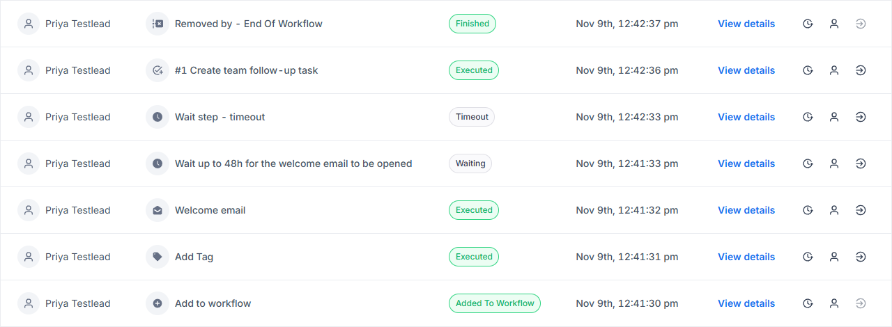

*Log of the 1 minute copy. The upper rows are the run with an assignee: timeout, task executed, end of workflow. The older run at the bottom shows the task skipped.*

What this proves: the timeout output of the wait step creates the task. What it does not prove: the 48 hour value itself ran its full length, and that an opened email takes the other output (no email can be delivered from the sandbox).

## Honest list of what was not run

- A welcome email delivered to an inbox and opened. Blocked by the sandbox, see above.
- The 48 hour timeout running to its end. Shown with a 1 minute copy.
- The Make webhook with an API key header.
- The workflow on any real sub-account or any real lead.

## Cleanup note

The Make Google Sheets connection asked for access to Sheets and to Drive when it was created. The `Lead log (test)` sheet and the Make scenario hold only invented data.
