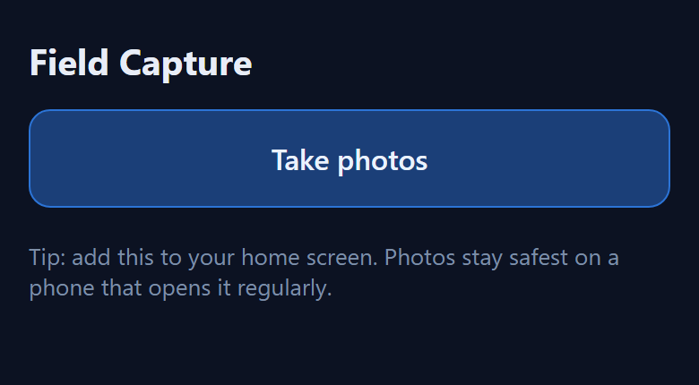
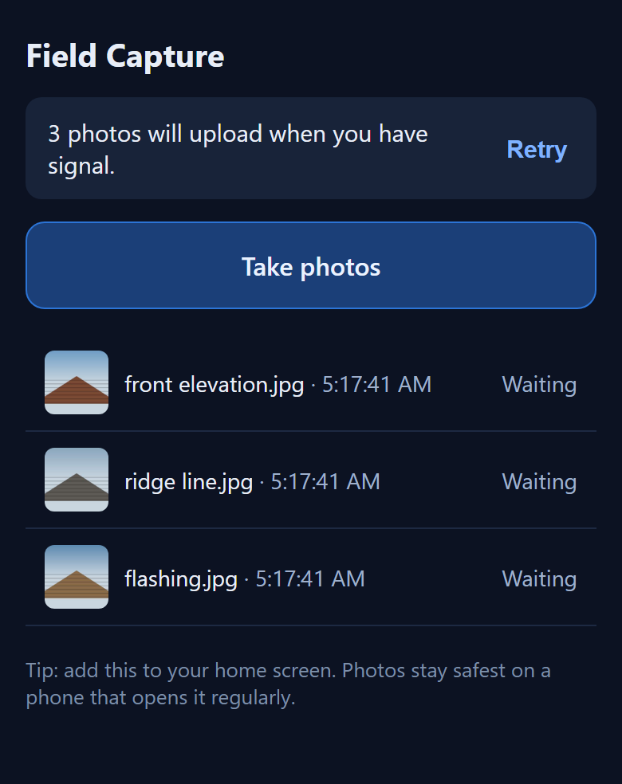
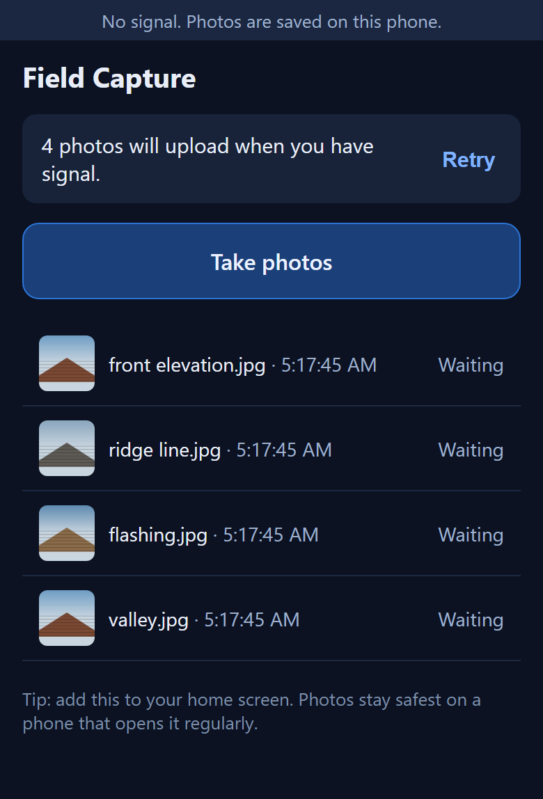
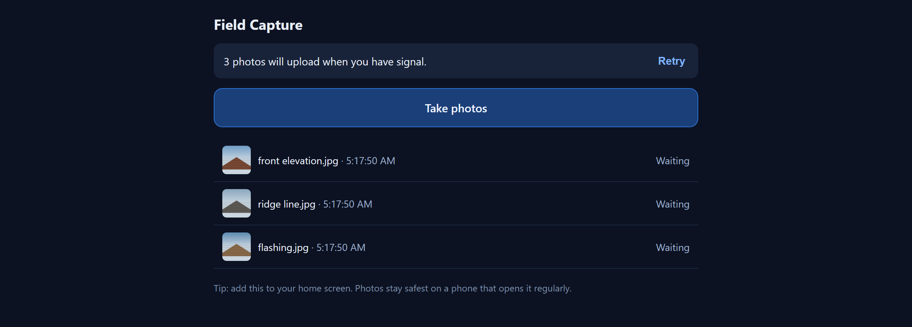

# The offline queue

A roofer stands on a roof with no signal. He takes four photos and drives away. Nothing may be lost. Nothing may be sent twice.

The recording at the top reads left to right. The signal drops and the strip appears. Four photos queue locally while the count climbs. Then the signal returns and the queue drains to empty on its own. The server received nothing during the offline stretch.

`tests/offline-drain.e2e.mjs` asserts exactly that. It then checks the server's own counter. So "the queue emptied" rests on the server's count as well as the client's own state:

```
PASS  offline strip shows when the connection drops
PASS  four photos captured with NO connection
PASS  all four are in the queue
PASS  the server received NOTHING while offline
PASS  the queue drained to empty after reconnecting
PASS  the server actually received the uploads      (abridged)
PASS  no orphaned photo bytes left on the device
```

| | |
|---|---|
|  |  |
| Nothing queued, so nothing is said. The quiet state is the absence of a badge, not a green tick. | Count plus action. Thumbnails are read back from device storage, so they survive a reload. |

### The state that matters



No signal, four photos held on the device, each one named and marked *Waiting*. The strip is deliberately quiet. It is a thin line of muted text, not a red banner. The app is working exactly as intended, and saying so loudly would be a lie about severity.

The same page at desktop width. A field tool still gets opened on a laptop in an office:



### Why the interface looks like this

The design came from reading real field apps, not from taste. **CompanyCam's actual mobile UI** is a thin muted strip reading "You seem to be offline." It also has a calm grey card reading "3 items waiting to upload." with a one-word action. The first draft here was a red alert bar. That is the documented **Housecall Pro** failure. Its persistent "OFFLINE Limited Functionality" banner false-fires on good signal and draws review complaints.

So the rule is **count plus action, never status plus colour**. The card disappears at zero (Encircle's decrementing-badge pattern). The copy says what will happen. web.dev's guidance is that non-technical audiences misread the word "offline".

Two more borrowed decisions. **Capture never blocks on a save.** Encircle earned a 3-star review for making users save one picture before taking the next. **GPS and time are stamped at capture, not at upload.** The upload can be hours later.

Accessibility was checked against the spec, not assumed. `role="status"` carries an implicit `aria-live="polite"` and `aria-atomic="true"`. MDN documents it as **inappropriate for a frequently-updating counter**, since every photo would fire a full announcement. So the count is plain text. One polite region announces transitions only. The queue is a plain list with real buttons, never a listbox holding buttons.
