# Pipelines, funnels and a course in a HighLevel sandbox

A pipeline with four stages, a workflow that creates an opportunity and moves it to the next stage, a two page funnel with a form, a course with an offer, and an SMS step. All of it was built by hand in the HighLevel UI on 2026-11-10 in the free developer sandbox (sub-account `ASC Test Tenant B`), after the form and workflow page in [lead-welcome-workflow.md](lead-welcome-workflow.md). Every contact is invented: `example.com` addresses and 555 phone numbers. Nothing here is a client system.

Two things did not work and are stated where they happened and again under Limits: a submission through the public funnel page was not completed because of a bot check, and the SMS step is refused by the platform. The funnel itself is published. It first could not be, because the sandbox had no domain, and a free `dynv6.net` subdomain fixed that the same day (section 2). The numbers in square brackets are the screenshots in `screenshots/pipelines-funnels/`.

| Part | Built | Run and read back | Blocked |
|---|---|---|---|
| Pipeline, 4 stages | yes [01, 02] | yes [09] | no |
| Workflow that creates and moves an opportunity | yes [03, 04, 06, 07] | yes, with a tag trigger [08, 09, 10] | the form trigger could not be run |
| Funnel with landing page, thank you page, form, button | yes [11, 12, 13] | published on `https://funnel.ghl-lab-dc.dynv6.net/course-enquiry`, both pages load signed out [27, 28, 29] | a submission through the page [18, 32] |
| Course with module, lessons, offer | yes [19, 20, 21, 22, 23] | member view opened as an admin preview [25] | payments, a real member sign in [24, 26] |
| SMS step | yes [05] | ran, the message failed [08, 10] | delivery |

A JSON read back of the pipeline, funnel, workflow and course is in [pipelines-funnels-memberships.export.json](pipelines-funnels-memberships.export.json), with ids replaced by placeholders.

## 1. Pipeline, and a workflow that moves the opportunity

**The pipeline.** `Course enrolment`, four stages: New lead (20 percent), Contacted (40), Enrolled (100), Lost (0). The create dialog starts with four stages named New Lead, Contacted, Proposal Sent and Closed, so two were renamed and the probabilities were changed. [01] The pipelines list shows it with 4 stages. [02]

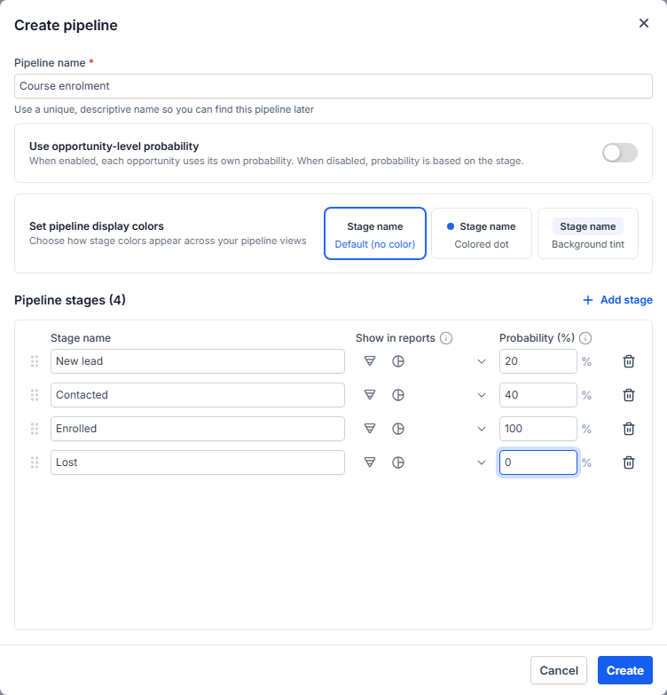

*The create dialog with the four stages.*

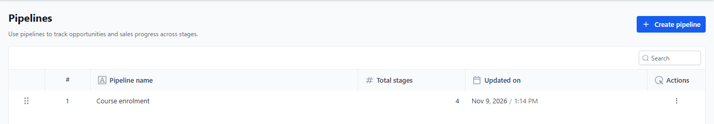

*The pipeline after saving. The green note is HighLevel's "Pipeline created".*

**The workflow.** `Course enquiry to pipeline`, published. [03]

- Trigger 1: Form submitted, filter `Form is any of Course enquiry (test)`. The form is a copy of `Lead intake (test)` made with the Duplicate action in the forms list, so the older workflow does not fire for it.
- Trigger 2: Contact tag, `Tag added includes course-enquiry`. This is the one that was run, because a submission through the funnel page could not be made (see Limits). The tag was created through the API first so it shows in the picker.
- Step 1, Create opportunity: pipeline Course enrolment, stage New lead, opportunity name `Course enquiry` plus the contact's first name. [04]
- Step 2, SMS. [05]
- Step 3, Wait for a set period of time, 1 minute. [06]
- Step 4, Update opportunity: pipeline Course enrolment, pipeline stage Contacted. [07]

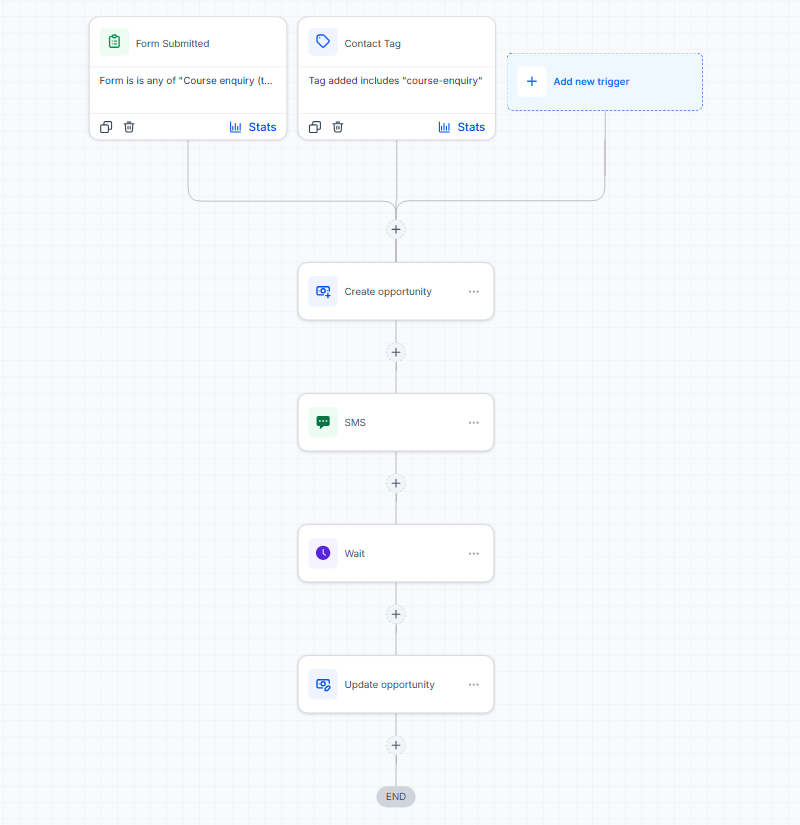

*Two triggers, then Create opportunity, SMS, Wait, Update opportunity.*

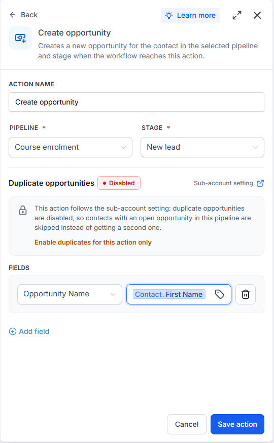

*The Create opportunity action. HighLevel marks the older Create/Update opportunity action as soon to be deprecated, so the separate Create opportunity and Update opportunity actions are used.*

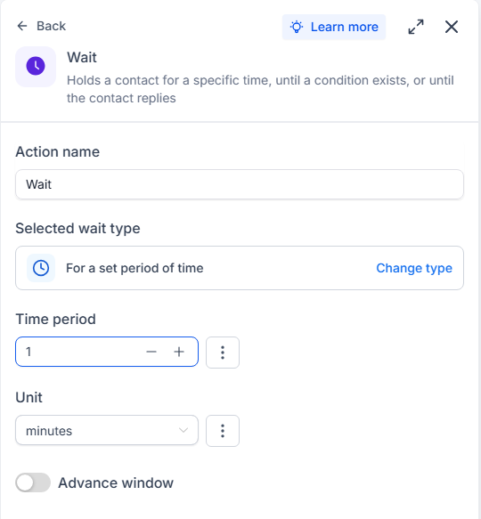

*The wait step set to 1 minute.*

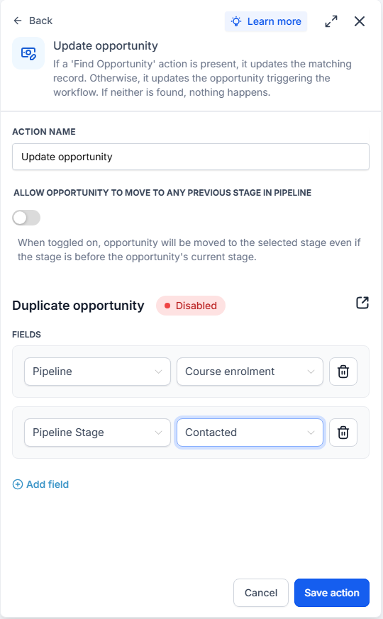

*The Update opportunity action. Its help text says it updates the opportunity from a Find Opportunity step if there is one, and otherwise the opportunity that triggered the workflow. There is no Find step in this workflow, and the board and the API show it moved the opportunity that step 1 had created.*

**The run.** A contact `Dana Funneltest` was created through the API with the tag `course-enquiry`. The execution log shows Add to workflow at 2:01:18 pm, Create opportunity at 2:01:20, SMS at 2:01:21, the wait starting at 2:01:22, Wait Finished at 2:03:36, Update opportunity at 2:03:39. [08] The 1 minute wait took 2 minutes 14 seconds. HighLevel's own log shows it, so it is stated here as measured and not as 1 minute.

The opportunities API, polled every 3 seconds, showed the opportunity created in New lead at 20:01:20 UTC and updated into Contacted at 20:03:37 UTC (the log above is in Central time). Two more contacts, `Eli` and `Fay`, were created the same way. The board read with Fay inside the first minute shows her in New lead while Eli and Dana already sit in Contacted. [09] The opportunity was moved by the workflow action. No card was dragged by hand.

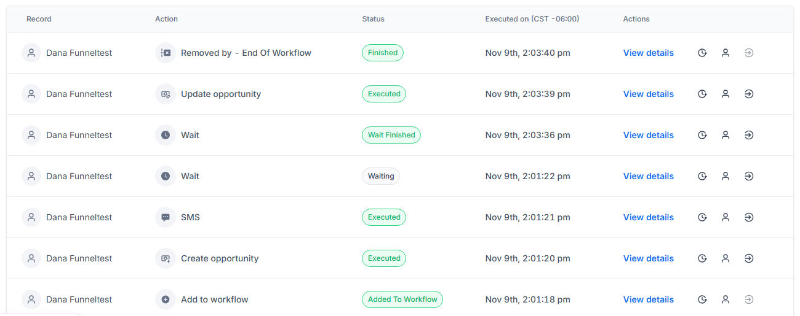

*The execution log for Dana. The SMS row says Executed; see section 4 for what happened to the message.*

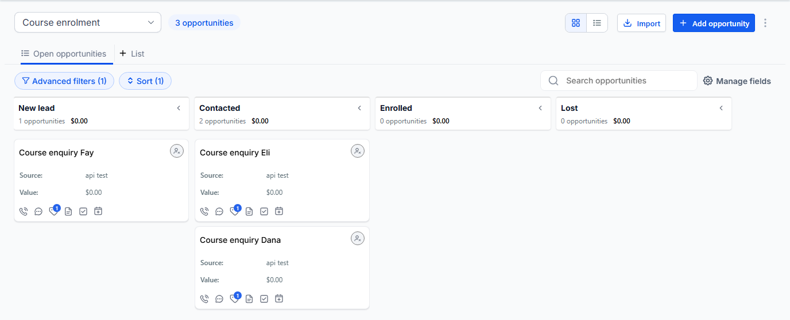

*The Course enrolment board. Fay is in New lead. Eli and Dana were moved to Contacted by the workflow.*

## 2. Funnel with a landing page and a thank you page

The funnel `Course enquiry funnel` has two steps, built from blank in the funnel builder. Before any domain was connected the funnel overview said "Please add a domain in the settings to see your Funnel live!" [11]

- Step 1, `Course enquiry landing page`, path `/course-enquiry`: a headline (`Start the free Spreadsheet Basics course`), a paragraph, and the Form element pointing at `Course enquiry (test)` with its redirect set to Go to Next step. The form brings its own Submit button. [12]
- Step 2, `Thank you page`, path `/thank-you`: a headline, a paragraph and a button `Open the course area`. The button's link target was not set. [13]

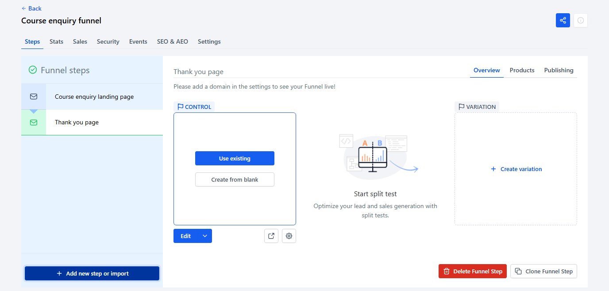

*The two steps.*

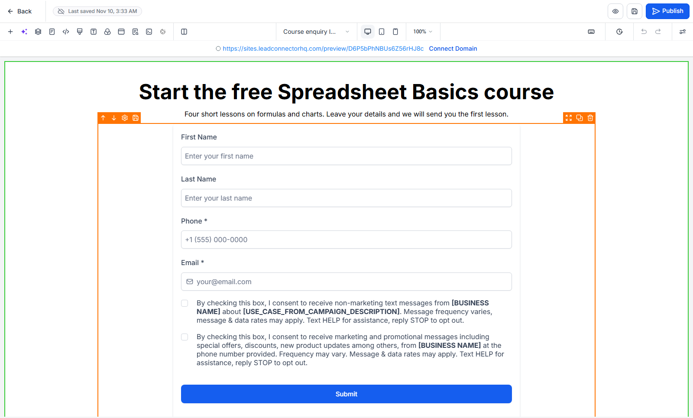

*The landing page in the builder. The two consent boxes and their `[BUSINESS NAME]` text come with the form copied from the earlier test form and were left as they were.*

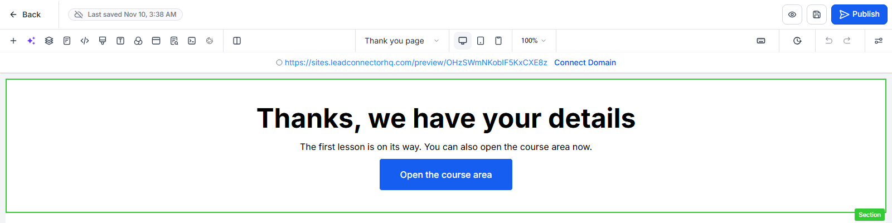

*The thank you page.*

**Publishing first did not work.** Publish opened a dialog that says "At least one domain needs to be selected before publishing funnel." and "You do not have any domains yet", with Purchase Domain and Connect Domain. [14] The funnel's Domain list holds only "Please select a domain". [15] The sub-account's Domains page offers Purchase domain, Transfer-In Domain and Connect a domain, and no free default domain. [16] The API agrees: the funnel's `domainId` is an empty string. Buying a domain costs money and the sandbox owned none, so a free one was looked for (next part).

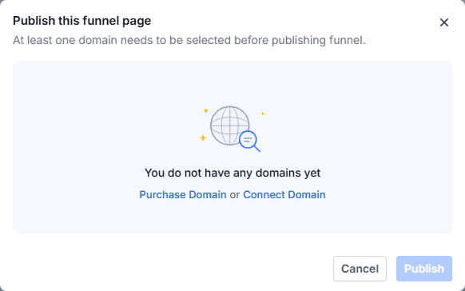

*The publish dialog.*

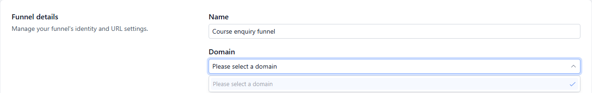

*The Domain list of the funnel settings.*

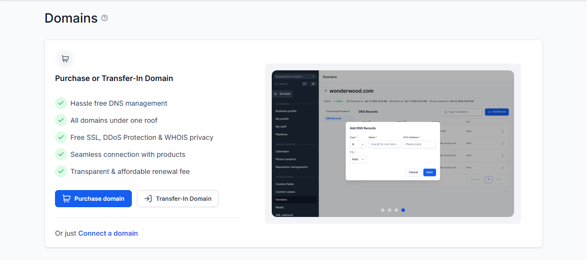

*The sub-account's Domains page. The sample picture on the right is HighLevel's own.*

**A free domain, and publishing.** Nothing was bought and no card was used. Free routes were tried in order, and each stopped where a person has to prove they are human. That check was left alone every time and never worked around.

- DigitalPlat FreeDomain took a GitHub sign in, then asked for a legal name, phone number and street address, and its form ends in a Cloudflare Turnstile checkbox, "Verify you are human". Stopped there.
- FreeDNS did not load from this machine (connection timed out).
- DuckDNS took a GitHub sign in. Adding a name failed twice with "error: reCaptcha failed, please try again." Stopped there.
- dynv6, a free dynamic DNS service that hosts its own zones and has a full record editor, took an email and a password. Its email confirmation page showed a reCAPTCHA checkbox, "I'm not a robot", and the account owner ticked it by hand. That is the only human check that was passed in the whole run.

After that the steps were these. A zone `ghl-lab-dc.dynv6.net` was created at dynv6 with no records. In the sub-account, Sites, Domains, Connect a domain, Funnel/Website/Store/Blog/Webinar, the domain `funnel.ghl-lab-dc.dynv6.net` was entered and Add record manually chosen. HighLevel asked for one record: type CNAME, host `funnel.ghl-lab-dc`, required value `sites.ludicrous.cloud`. [30] The record was added at dynv6 as name `funnel`, data `sites.ludicrous.cloud.` with a trailing dot. [31] The first save went in without the dot and dynv6 read it as relative, storing `sites.ludicrous.cloud.ghl-lab-dc.dynv6.net.`, so the record was edited. A DNS lookup against 8.8.8.8 then answered `funnel.ghl-lab-dc.dynv6.net canonical name = sites.ludicrous.cloud`.

Verify records was still spinning after 12 seconds the first time, and HighLevel's own note says DNS updates can take up to 30 seconds. A later press completed in about 30 seconds. The network log shows a conflict check (`conflict: false`), a validate call that returned `state: CONNECTED`, then the domain being created and attached to the location. The funnel's Domain list then offered `funnel.ghl-lab-dc.dynv6.net`. It was selected and saved, and after a reload the settings showed it. [27] Publish was pressed once in the landing page builder. Signed out, in a fresh headless browser, `https://funnel.ghl-lab-dc.dynv6.net/course-enquiry` answered HTTP 200 over https with the landing page [28], and `https://funnel.ghl-lab-dc.dynv6.net/thank-you` answered HTTP 200 with the thank you page. [29] The funnel's own path `/course-enquiry-funnel` answered 200 with the same landing page.

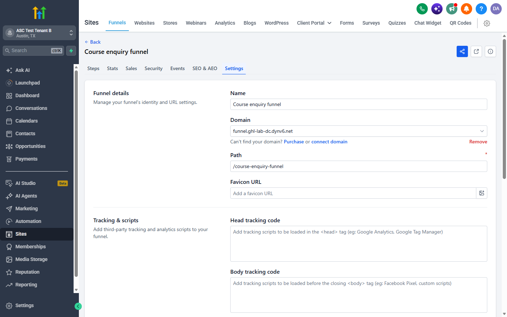

*The funnel's Domain setting after the save, read back after a reload. The Payment mode switch on the same page was already on and was not touched.*

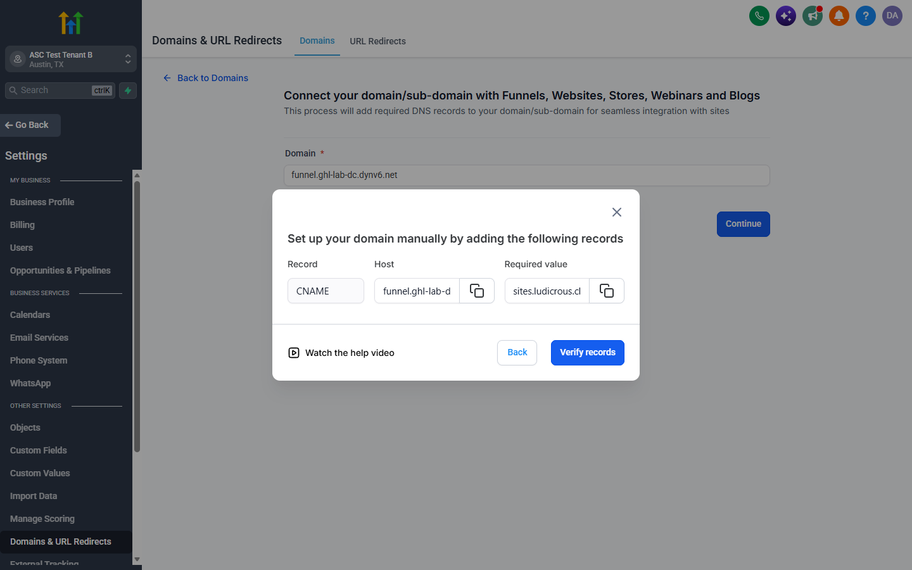

*The record HighLevel asks for. The Host box is cut off by the dialog width: it reads `funnel.ghl-lab-dc`, and the value reads `sites.ludicrous.cloud`.*

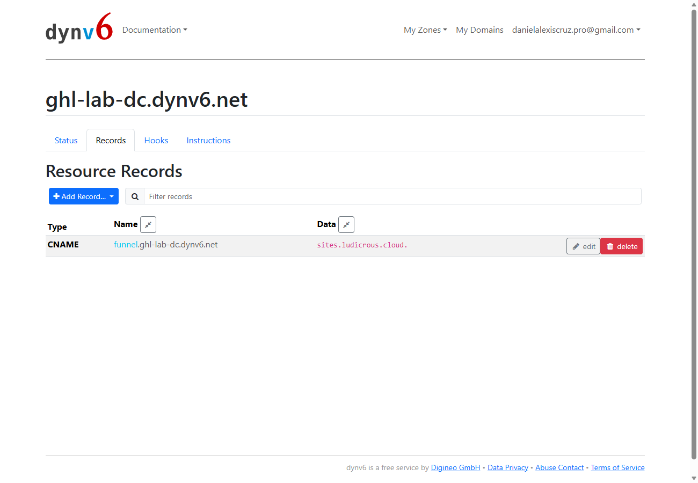

*The CNAME at dynv6 after the edit.*

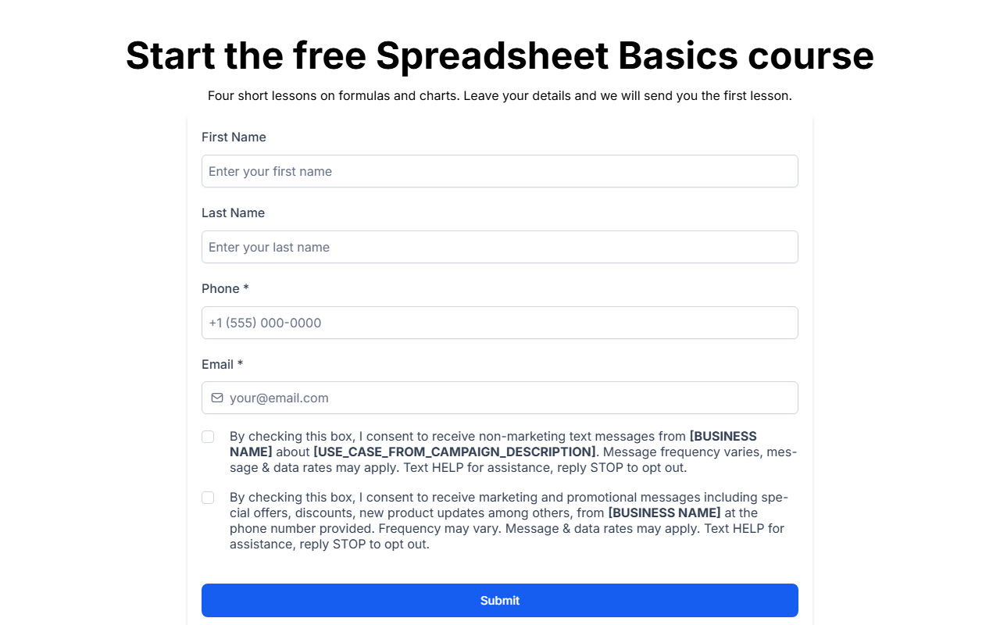

*The landing page on the published address, signed out.*

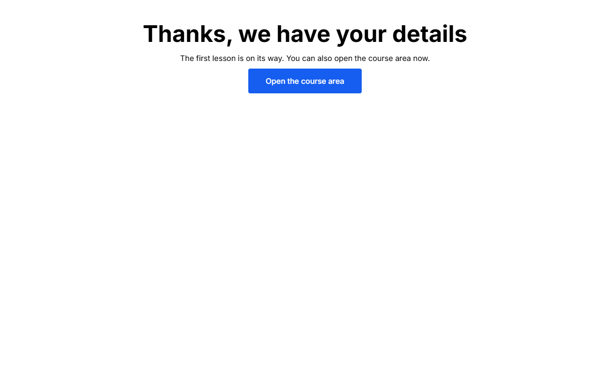

*The thank you page on the published address. It was opened by its address. It was not reached through the form (see below).*

**Earlier, with the preview link.** The builder shows each page's preview link, `https://sites.leadconnectorhq.com/preview/<PAGE_1_ID>` for the landing page. In a plain signed out browser it returned HTTP 200 and showed the headline, the paragraph, the four fields (First Name, Last Name, Phone, Email), the two consent boxes and the Submit button. [17] The page title was an empty string. The preview link is not a published page. That was true when it was checked, before the domain was connected.

**A submission through the page created nothing.** Before publishing, in that signed out browser the four fields were filled with an invented lead and Submit was clicked. The form cleared. [18] The browser made two `form-survey-event` posts (HTTP 201) and no form submit request. The contacts API before and after listed the same single older contact. So no contact was created through the funnel page, and the Form submitted trigger was never fired. The form's own share link was tried too: the page console printed `[Cloudflare Turnstile] Error: 600010` after Submit and again no submit request went out. That is a bot check on the form, and it was not worked around.

**The same on the published address.** In a fresh headless browser the page console printed `[Cloudflare Turnstile] Error: 600010.` as soon as the page loaded and again after Submit. The first fill used an invented phone number the page's own check refused ("Invalid phone number"), so the phone was changed to `+1 (202) 555-0100`. The fields were then filled with `Test`, `Lead` and `test@example.com`, and Submit was pressed. The page did not move to the thank you page: the URL stayed on `/course-enquiry` and the fields stayed filled. [32] One run logged a request to `forms/submit` and no response was read from it. The sub-account's Contacts list afterwards held five contacts, none of them `Test Lead`. So no contact was created through the published funnel by this browser, and the redirect from the landing page to the thank you page was not seen working. A person submitting the form in an ordinary browser is still the missing step.

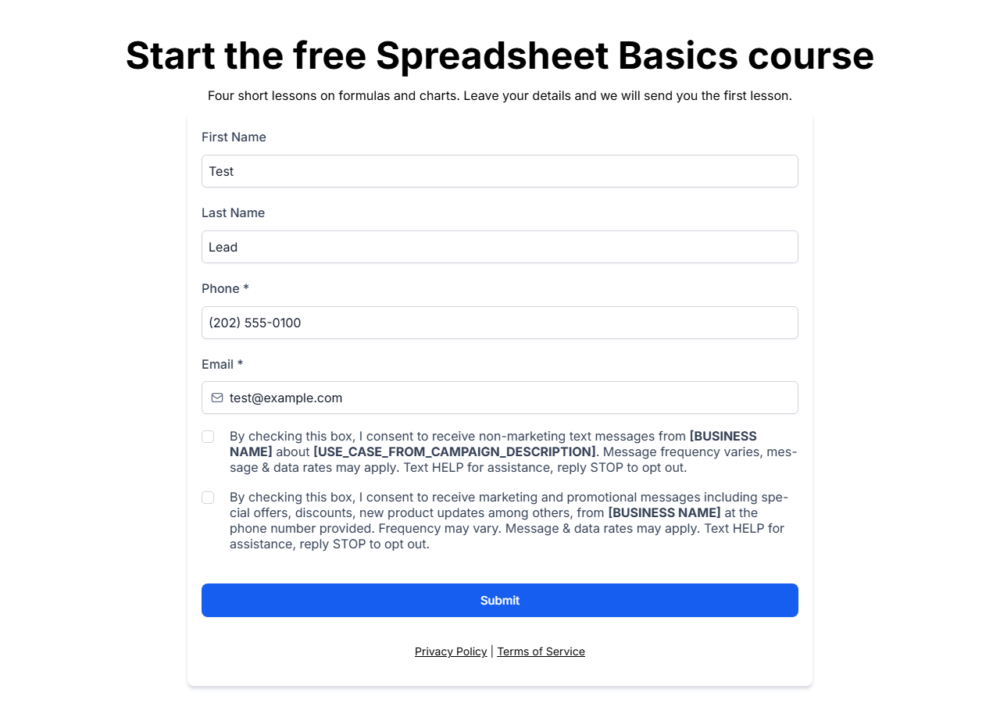

*The published landing page after Submit with a filled form: no move to the thank you page.*

*The preview link in a signed out browser.*

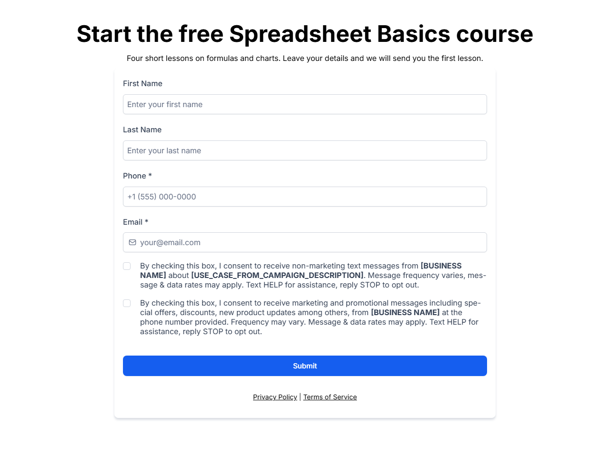

*The same page after Submit with a filled form: the fields are empty again and no contact exists.*

## 3. Course, module, lessons and an offer

Memberships, Courses, Products, Create New, Start from scratch is a three step form: title and description, a thumbnail (skipped), and pricing. [19] Pricing offered Free, Recurring and One Time. Free was chosen.

The result is the course `Spreadsheet Basics` with one module, `Course Contents`, and a starter outline that HighLevel filled in: a Welcome Badge, five lessons (`Welcome Aboard!`, `Lesson 1: The What`, `Lesson 2: The Why`, `Lesson 3: The How`, `What's Next?`) and a Course Completion Credential, all Published. [20]

- **Video lesson.** The five starter lessons are video lessons from the template. Their Lesson Media area is empty (it accepts mp4, webm, mov, aac, mp3 and wav), so they are placeholders and no video was uploaded. The template's own description text is still in them. [22]
- **Text lesson.** `Lesson 4: Reading a chart (text)` was added with Add Content, Add Lesson into the module. It has no media, only a written description, and was saved with Save and Publish. HighLevel said "Lesson saved and published successfully." [21]
- **Offer.** Offers, Create Offer: `Spreadsheet Basics free offer`, type Free, price USD 0.00. It was created as a Draft and then set to Published in the Visibility menu. [23] The offer page shows the warning "To collect payments from your customers, connect a payment processor like Stripe." No processor was connected, and no payment was tested. [24]
- **Member view.** The eye icon on the text lesson opens `https://<location>.app.clientclub.net/courses/products/...` with a blue bar that reads "You're in admin preview mode. This is how members see this course." It shows the lesson text, the course contents list of 6 lessons and a comment box. Mark As Complete says "You are an admin, you can not mark this post as completed". [25] That is the admin preview and not a signed in test member.

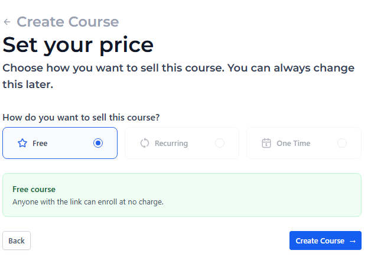

*The pricing step of the course form.*

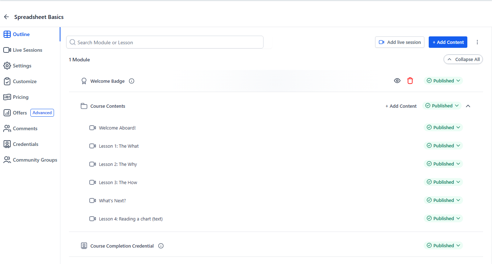

*The outline: one module, six lessons, all Published.*

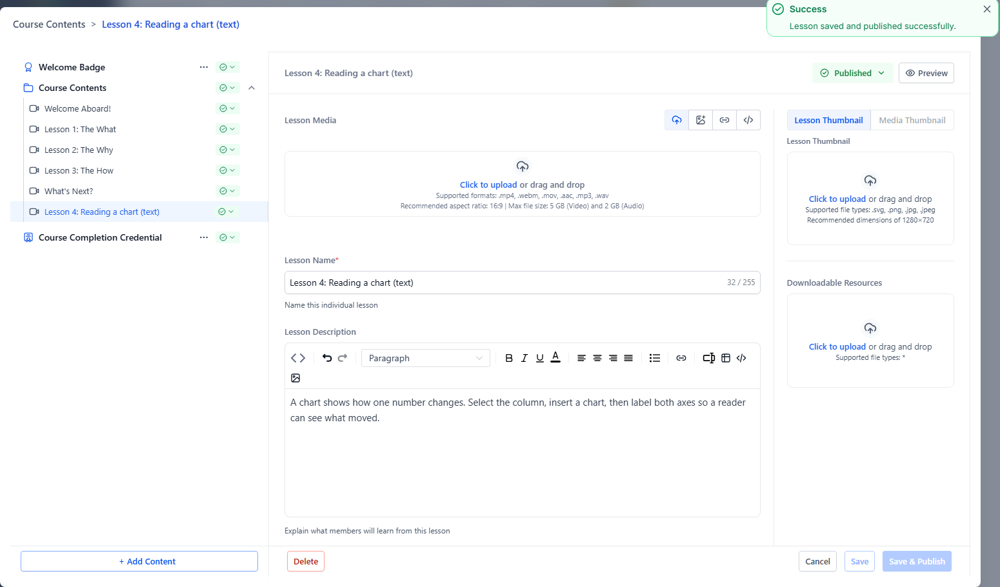

*The text lesson after Save and Publish.*

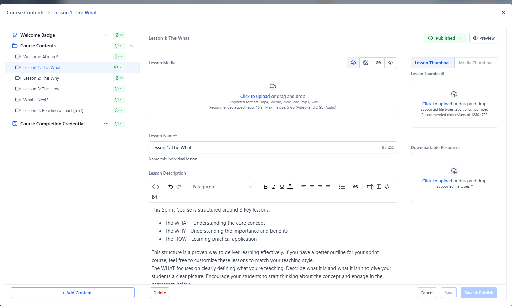

*A starter lesson. The media area is empty.*

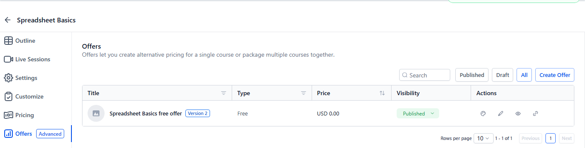

*The offer, Published.*

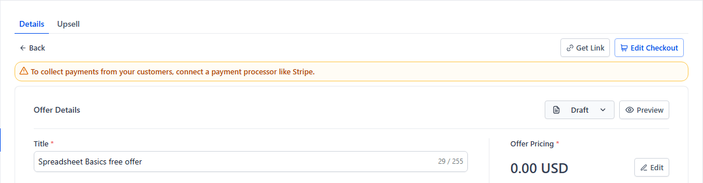

*The offer page with the payment processor warning, saved while it was still a Draft.*

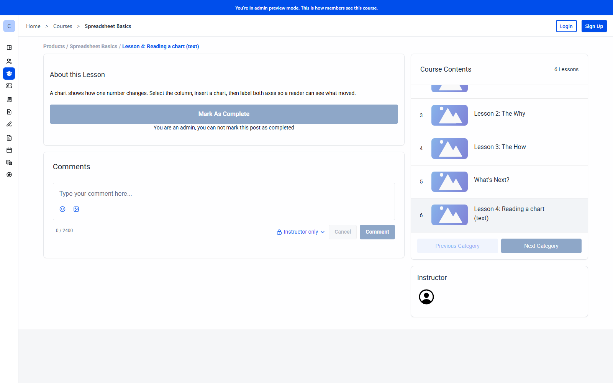

*The text lesson as members see it, in admin preview.*

**A real member sign in was not done.** The course's member portal page lists a secure code sent by email, or a password. [26] Email sending is blocked from this sandbox (see the older page), so the code route was not tried. The Sign up button on that page did nothing in a signed out browser in the 10 seconds it was watched, and no member account was created.

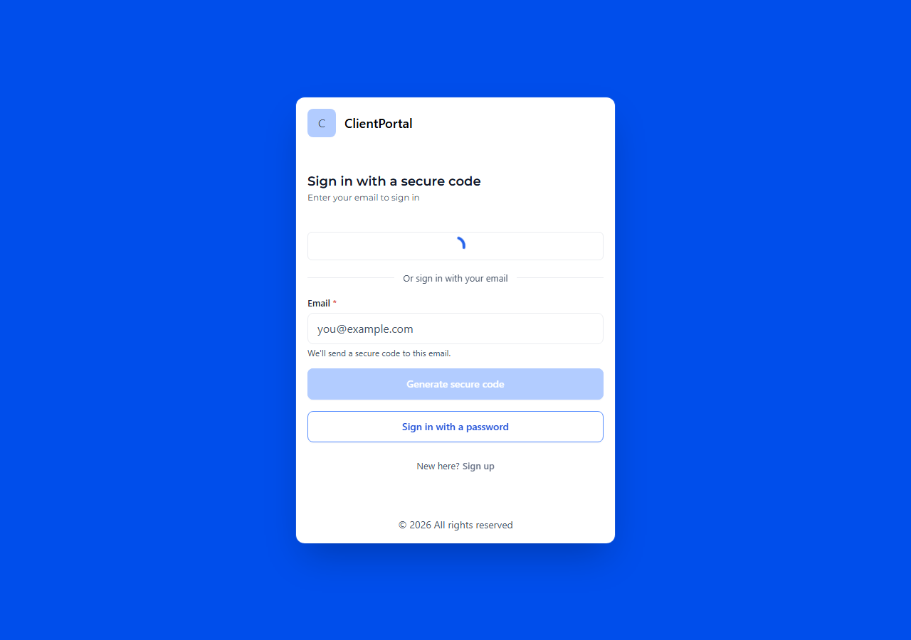

*The member portal sign in page, signed out.*

## 4. The SMS step

The SMS action sits between Create opportunity and Wait with the text `Hi {{contact.first_name}}, thanks for your interest in the Spreadsheet Basics course. Reply STOP to opt out.` [05]

What the sandbox did: the execution log marks the SMS step Executed [08], and the message in the contact's conversation is shown with a red warning and a Try again link. Hovering the warning shows `Trial mode not enabled for this agency`. [10] The message record read through the API carries `status: failed` and `error: Trial mode not enabled for this agency`. No SMS was delivered, and no delivery is claimed. The step still ran in order, so the wait and the stage move after it ran too.

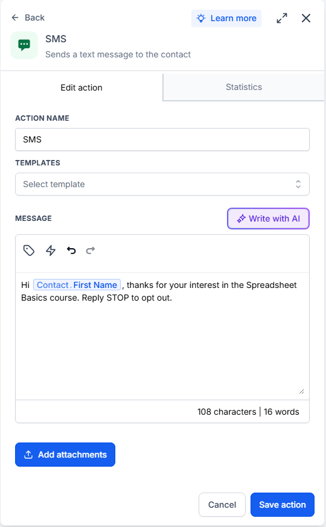

*The SMS action with the merge field.*

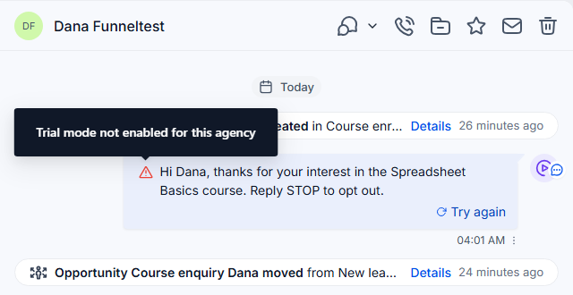

*The failed message and the platform's reason.*

## Limits, with the exact messages

- **The domain is a free one, not a bought one.** The funnel runs on `funnel.ghl-lab-dc.dynv6.net`, a subdomain of a free dynv6 zone. Before it, publish said "At least one domain needs to be selected before publishing funnel." and "You do not have any domains yet". [11, 14, 15, 16] Three other free routes stopped at a human check or did not load, so a free dynamic DNS name was used and not a registered domain of its own. It is a lab address and not one a business would put on a campaign.
- **No funnel submission.** The preview page and the published page do not create contacts from an automated browser, and the form raises a Cloudflare Turnstile error (`Error: 600010`) that was not worked around. A person submitting it by hand is the missing step. The Form submitted trigger is built and was not fired. [17, 18, 32]
- **SMS is refused.** `Trial mode not enabled for this agency`, message status `failed`. The execution log still says Executed. [08, 10]
- **Email is blocked** from a sandbox, as found on the earlier page, so no email step was added here.
- **No payments.** The offer is free and the offer page says to connect a processor such as Stripe. [24]
- **No member account.** The member view was opened as an admin preview. [25, 26]
- **The wait ran long.** 1 minute set, 2 minutes 14 seconds measured. [08]
- **Run on a tag, not a form.** The opportunity run used the Contact tag trigger with contacts created through the API. [03, 08, 09]
- **Sandbox only.** The sandbox account expires up to 6 months after creation and its data can be reset.

## Not run

- A contact created by a person through the published funnel.
- The thank you button's link target, and the funnel's redirect from the landing page to the thank you page.
- A hand drag of an opportunity between stages. The workflow moved them.
- A delivered SMS, a delivered email, a payment, a member sign in.
