# A snapshot of the built sub-account, and what the sandbox says about four settings pages

Two things were done in the free HighLevel developer sandbox on 2026-11-10, after the work in [lead-welcome-workflow.md](lead-welcome-workflow.md) and [pipelines-funnels-memberships.md](pipelines-funnels-memberships.md). First, a snapshot named `Course enquiry kit (test)` was created from the sub-account `ASC Test Tenant B`, which holds the form, the two workflows, the pipeline, the funnel and the course. It was created, read back in the Snapshots list and read back a second time through the API. Second, the sandbox's own pages for white label, single sign on, the branded mobile app and phone numbers were opened and read, and nothing on them was saved. Every record is invented. Nothing here is a client system. The numbers in square brackets are the screenshots in `screenshots/pipelines-funnels/`, which continue from 32.

| Part | Done | Read back | Result |
|---|---|---|---|
| Snapshot `Course enquiry kit (test)` | created from `ASC Test Tenant B` [34, 35, 36] | Snapshots list [37], contents dialog with 11 assets [39, 40], API list | exists, version v0 |
| White label page | opened, read, nothing saved [43, 44] | | open form, no plan gate text on the page |
| Single sign on page | opened, read, nothing pressed [45] | | page with an Enable SSO button, no plan gate text |
| Branded mobile app page | opened, read, two dialogs read and closed [50 to 54] | | custom app is a paid choice, `from $497/m` |
| Phone numbers | agency and sub-account pages read [46 to 49, 56] | | sub-account says its phone system requires configuration |

## 1. The snapshot

**Where it is.** In the agency view, Account Snapshots. Before anything was done the My snapshots tab held no snapshots. [33]

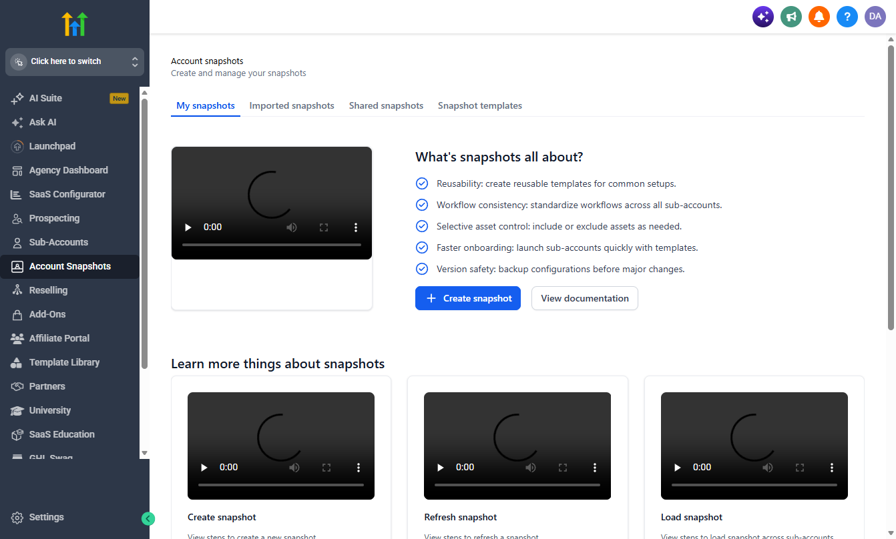

*The My snapshots tab before the snapshot was made, with the Create snapshot button.*

**The dialog.** Create snapshot asks for a Snapshot name and a Sub-account. The name `Course enquiry kit (test)` was typed and `ASC Test Tenant B` was chosen from the two sub-accounts in the list. [34] Next showed a "Loading assets" step ("Preparing assets", "Fetching assets from the sub-account") with a progress count that ran to 55 and then opened the asset picker.

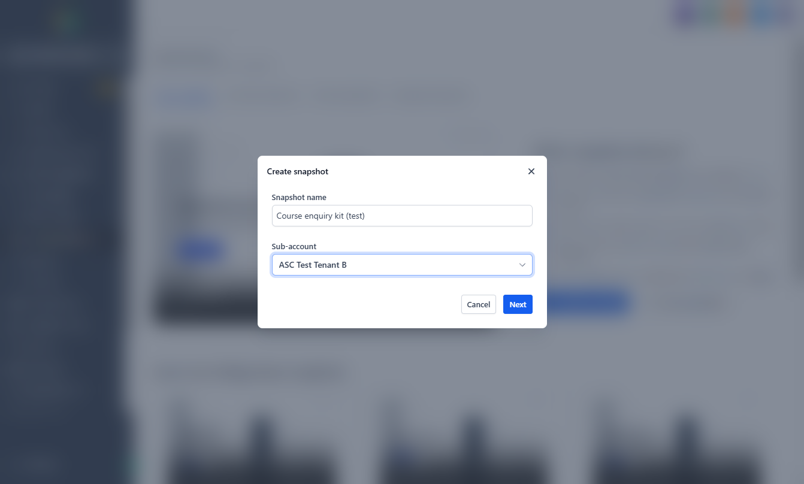

*The first dialog, filled in.*

**The asset picker.** The picker is headed "List of assets linked with sub-account" and listed 62 asset types, each with a count such as `Forms (0/2)` and a product category. The ones with something in them were Calendars (2), Certificates (2), Contact detail views (1), Custom fields (43), Custom values (1), Dashboards (1), Forms (2), Funnels & Websites (1), Knowledge bases (1), Membership offers (1), Membership products (1), Pipelines (1), Review settings (1), Tags (2) and Workflow (2). The list was read by scrolling and 56 of the 62 rows were captured, and every other row among them showed `0/0`. Six rows were not captured, so that list is not a full inventory.

Ticking a type ticks everything under it. Eight types were ticked: Forms, Funnels & Websites, Pipelines, Tags, Workflow, Certificates, Membership offers and Membership products. The certificate and the two tags are not on the list in the brief. They were added because the course has a completion certificate and the workflow triggers use the tags, so the kit would otherwise be missing things it points at. The custom fields, custom values and calendars were left out on purpose: they belong to the separate API work in [custom-fields-values-calendars.md](custom-fields-values-calendars.md), which was being changed at the same time. [35]

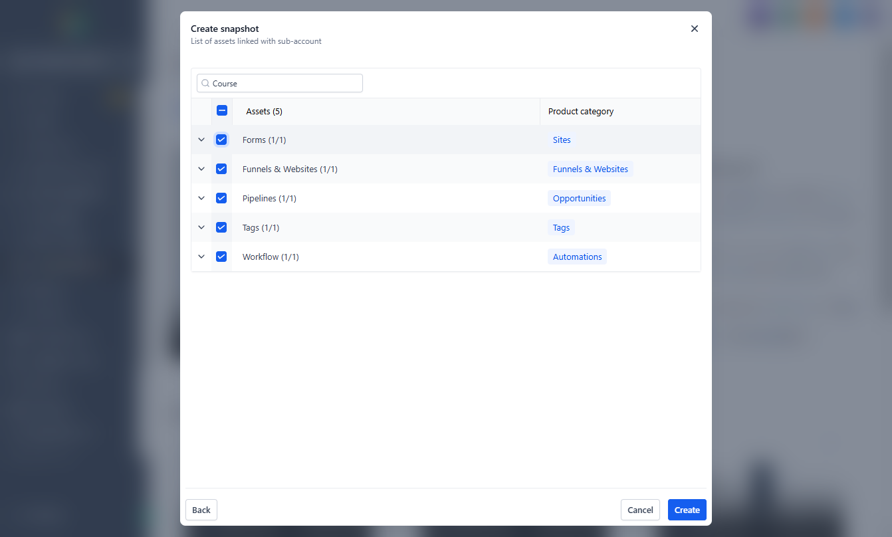

*The picker filtered by the word Course, with five types ticked. The Spreadsheet and Lead filters were used the same way for the course items and the older form and workflow.*

**Creating it.** Create showed a green note, "Success: Snapshot creation initiated successfully", and the list showed the row greyed out for a moment. [36] A short time later the row turned normal. [37] The list reads: name `Course enquiry kit (test)`, sub account `ASC Test Tenant B`, version `v0`, created on `Nov 10, 2026 3:38 PM`, last updated on the same minute. The times are as the page prints them. The row menu offers Settings, Copy snapshot ID, Share snapshot, Sell on marketplace, View history and Delete snapshot, and the row also has a plus icon, a refresh icon and an upload icon. None of those were pressed. [38]

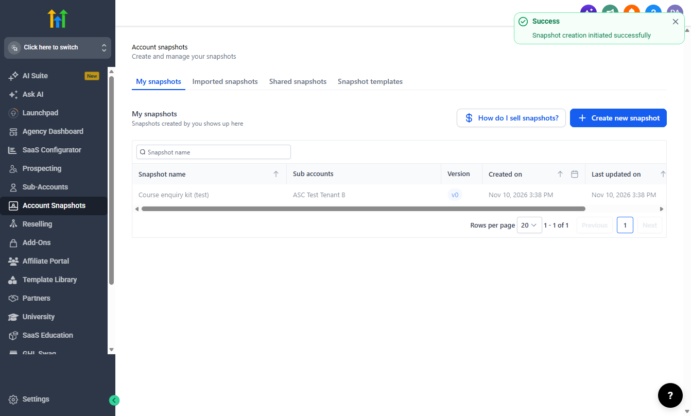

*The note straight after Create.*

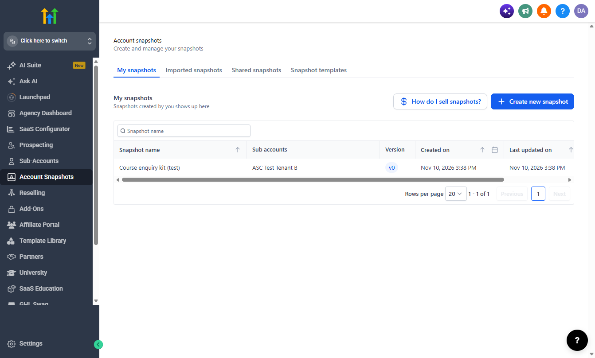

*The finished row.*

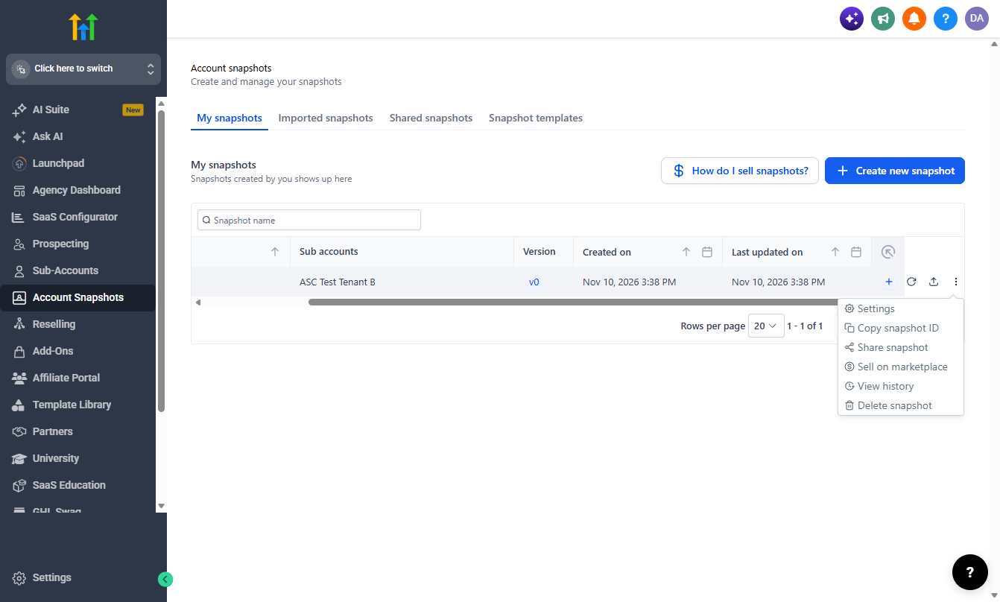

*The row menu, opened to read it and closed again with Escape.*

**What it contains.** Clicking the version `v0` opens "Snapshot details - Course enquiry kit (test)" with the label `v0-Current` and "Assets (11)". Expanding every row shows these names. [39, 40]

| Type | Items |
|---|---|
| Certificates (1) | Spreadsheet Basics Completion Certificate |
| Forms (2) | Lead Intake (Test), Course Enquiry (Test) |
| Funnels & Websites (1) | Course Enquiry Funnel |
| Membership Offers (1) | Spreadsheet Basics Free Offer |
| Membership Products (1) | Spreadsheet Basics |
| Pipelines (1) | Course Enrolment |
| Tags (2) | Course-Enquiry, New-Lead |
| Workflow (2) | Course Enquiry To Pipeline, Lead Welcome And 48h Follow-Up |

So the form, both workflows, the pipeline, the funnel and the course (the product, its offer and its certificate) are all in it. The dialog spells the names with capital letters its own way.

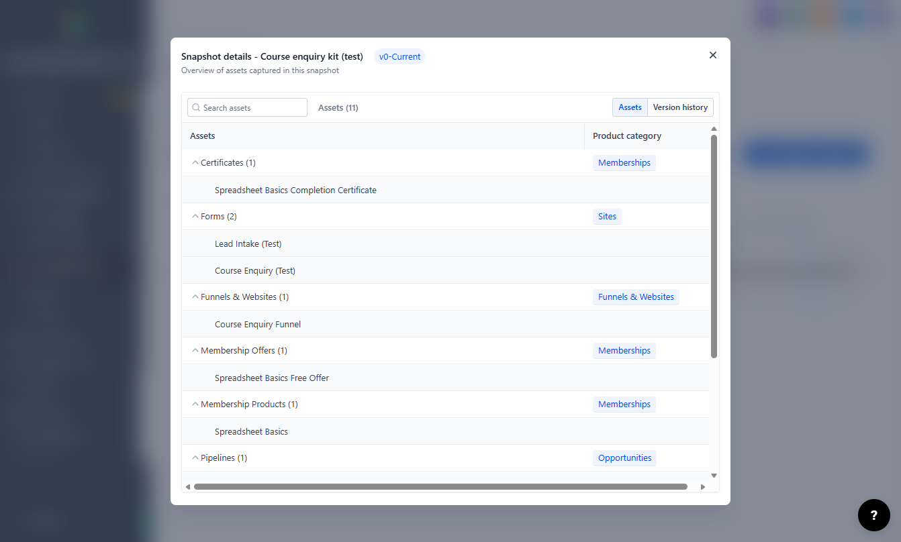

*The contents dialog, first half.*

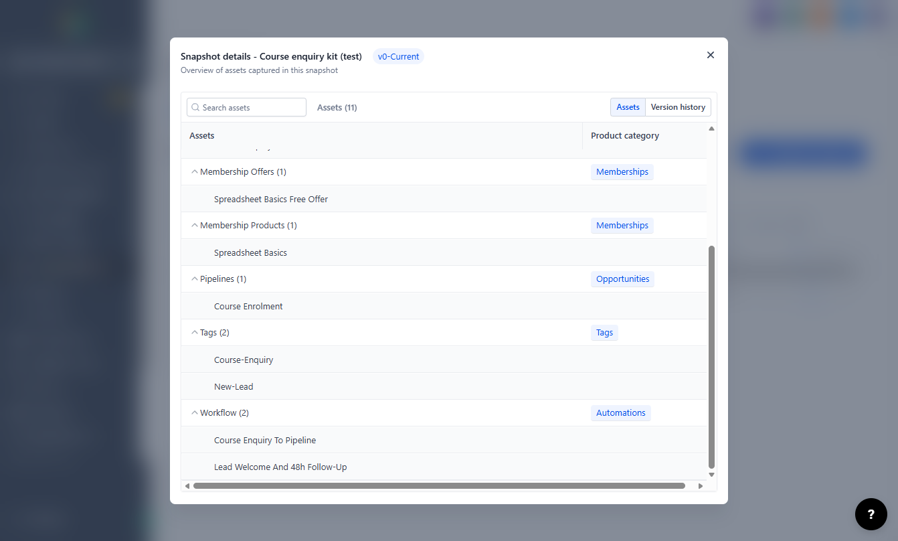

*The contents dialog, second half.*

**A second route, the API.** The stored sandbox token for the agency, sent as a Bearer token with the `Version: 2021-07-28` header, read `GET /snapshots/?companyId=<COMPANY_ID>` and answered HTTP 200:

```
{"snapshots":[{"id":"<SNAPSHOT_ID>","name":"Course enquiry kit (test)","type":"own"}]}
```

The list holds exactly one snapshot, with the same name, and its type is `own`, which means it was made in this account and not imported or shared in. The endpoint returns only an id, a name and a type, so the contents above come from the dialog and not from the API.
## 2. The four settings pages

All of this was done in the agency view of `DAC Dev Sandbox`, plus one sub-account. The agency Settings menu has these entries: My Profile, Company, Users, Billing, Workflow settings, Phone Integration, Email Services, System Emails, Announcements, Workflow - Premium Features, Workflow - External AI Models, Domain Purchase, Private Integrations, Affiliates, Custom Menu Links, Stripe, API Keys, Compliance, Labs, Audit Logs and Media Storage Usage. [41] There is no entry called White Label or Single Sign-On. Both are tabs inside Company. The Mobile App page is in the main sidebar, not in Settings. Inside the sub-account `ASC Test Tenant B` the Settings menu has Business Profile, Billing, Users, Opportunities & Pipelines, Calendars, Email Services, Phone System, WhatsApp, Objects, Custom Fields, Custom Values, Import Data, Manage Scoring, Domains & URL Redirects, External Tracking, Integrations, Private Integrations, Tags, Labs, Audit Logs and Brand Boards, and has no white label or single sign on entry. [55]

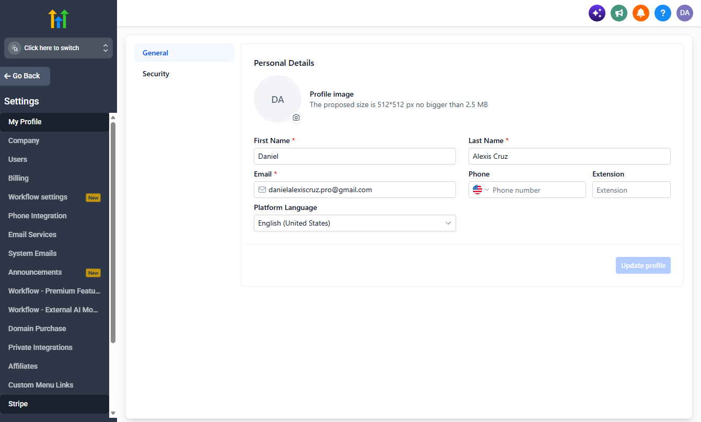

*The agency Settings menu, opened on My Profile.*

### Company and business profile

The agency Company Settings page has four tabs: Basic Details, White Label, Advanced Settings and Single Sign-On (SSO). Basic Details is an open form: Company Name `DAC Dev Sandbox`, Company Email, Company Phone, Company Website, Business Category, Business Niche, a usecase question, an address block and a Features section. [42] The sub-account's Business Profile Settings page is also an open form, headed "Manage your business profile information & settings", with the logo, Friendly Business Name `ASC Test Tenant B`, Legal Business Name, Business Email, Business Phone, a Branded Domain box and the address. [55] A black bar on 42 and 55 hides the account's relationship number and location id. Nothing was typed in either page.

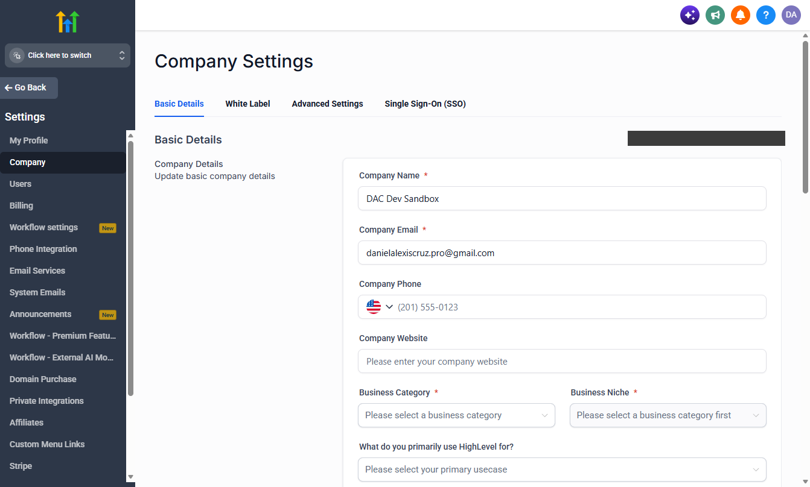

*The agency Company Settings page with its four tabs.*

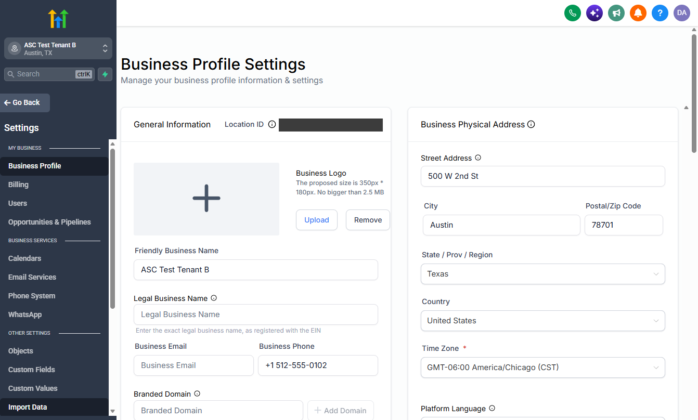

*The Business Profile Settings page of the sub-account.*

### White label

The White Label tab opens as a form with no plan or upgrade text on it. It starts with a blue note:

> You can now create and manage multiple white label brands!
> Create up to two unique white label brands, which can be assigned to SaaS plans as well as sub-accounts.

Below it are these parts: a Logo with an Upload logo button ("The proposed size is 350px * 180px. No bigger than 2.5 MB"), Brand name (filled with `DAC Dev Sandbox`), Brand email, Brand phone number, Domains with a "White Label Domain" box ("Please enter your white label domain and click on Add Domain") and an "API Domain" box ("Please enter your API domain and click on Add Domain"), Policies with a Privacy Policy URL and a Terms & Conditions URL, Custom JS, Custom CSS and a Theme choice of Light Theme or Dark Theme. [43, 44]

The buttons were read from the page: Add new brand, every Save changes and both Add domain buttons are disabled when the page loads, and Upload logo is not. The Add domain buttons stay disabled until a domain is typed. So the page lets an agency start setting a brand up, and the part that needs something this sandbox does not have is a domain of its own, since both domain boxes ask for one. No domain was typed and nothing was saved.

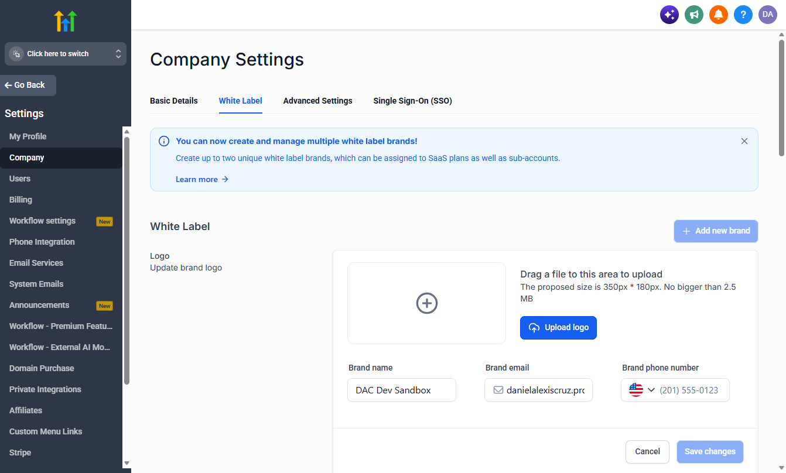

*The White Label tab. Add new brand is greyed out.*

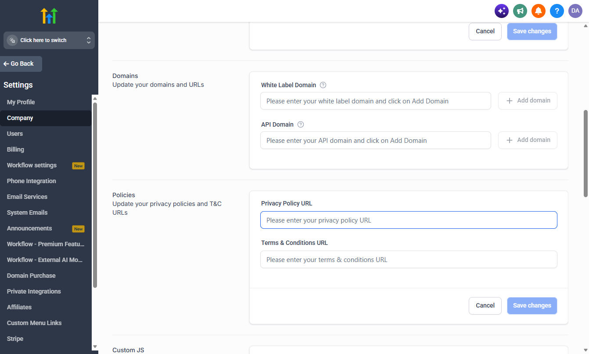

*The Domains and Policies parts of the same tab.*

### Single sign on

The Single Sign-On (SSO) tab says:

> Single Sign-On (SSO) allows you to access multiple applications with one set of login credentials. Set up SSO for your account to enhance security and streamline access to your applications.

It has a Learn More link at the top right and one blue button, Enable SSO. There is no plan gate or upgrade text on it. Enable SSO was not pressed, because pressing it may switch the feature on, and the Learn More link was not followed. The page content sits inside an embedded frame that the browser tool could not read as text, so the words above were read from the screenshot. [45]

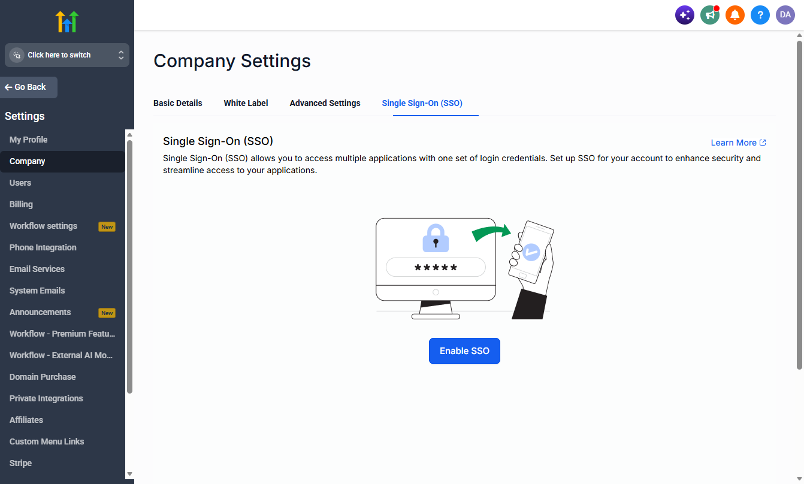

*The Single Sign-On (SSO) tab.*

### The branded mobile app

The Mobile App entry opens `/mobile-app-customiser`, headed "Agency Mobile App" with the line "Your agency mobile app made easy — choose from our free offerings or create your own whitelabel app, and start nurtu…" (the page cuts the sentence off there). [50] Under "Choose your app" and "Set your mobile app preference for your sub-accounts" it shows three cards. [51, 52]

| Card | Sub line | Tag |
|---|---|---|
| HighLevel App | With Highlevel Brand Guidelines | Lifetime Free |
| Lead Connector App | With Grey Labelled Brand Guidelines | Lifetime Free, and a button reading "Selected App" |
| Custom Agency App | Your Brand Guidelines | from $497/m |

So the branded app, the one with the agency's own name and colours, is the paid card. The sandbox has the free Lead Connector App selected already. Two dialogs were opened to read and then closed:

- Mobile App Settings has a switch, off, for "Show clients an easy way to download the mobile app" ("Adds a dedicated page to your subaccount with QR codes and links, making it simple for clients to download the app on iOS and Android."), then "Select the app type" with the three apps and Lead Connector App ticked, and the buttons Cancel and Confirm. Cancel was pressed. [53]
- The Learn More button of the Custom Agency App card opens "Your Custom Agency App" with three boxes, Brand, Agency suitability and Value proposition. The Brand box starts "The Custom Agency Mobile App puts your brand in the spotlight. Apply your own color palette, rearrange or hide native modules, and create entirely new modules by naming them and embedding any URL". The Agency suitability box says it is for agencies "ready to elevate their brand with a fully white-labelled experience across both web and mobile". The buttons are Close and Start Customization. Close was pressed, and Start Customization was not. [54]

Nothing was selected or confirmed, and the page reads the same afterwards with Lead Connector App still selected.

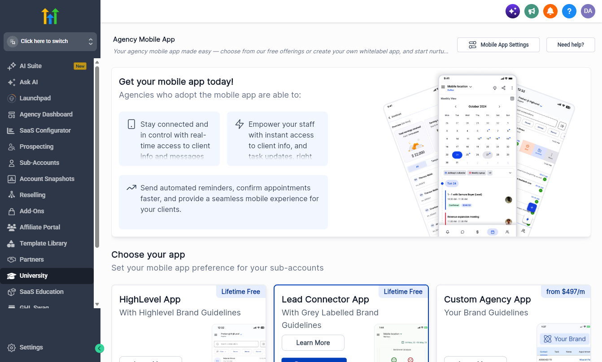

*The top of the Agency Mobile App page.*


*The three app cards.*

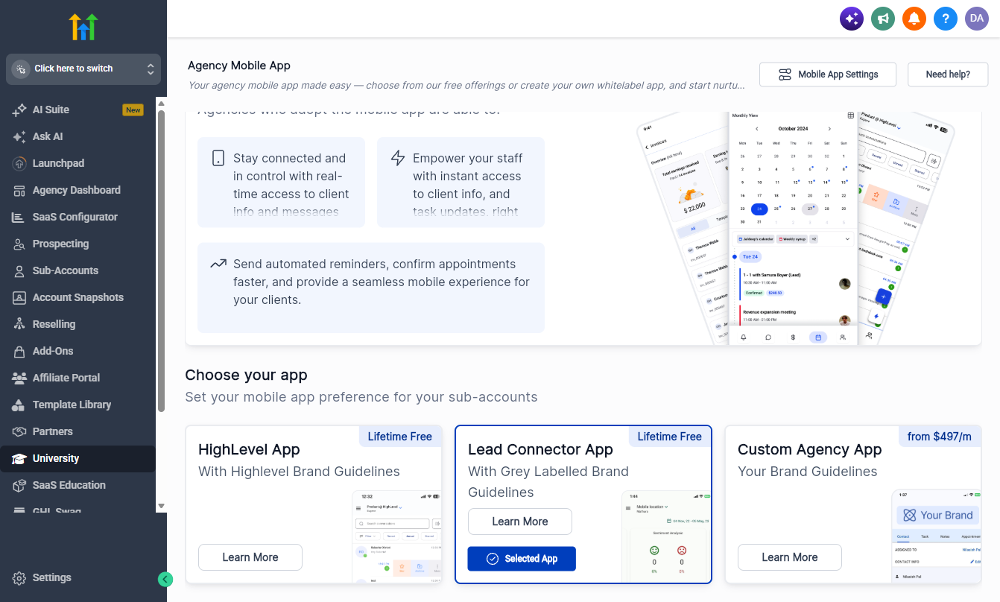

*The same cards scrolled to the bottom, with `from $497/m` on the Custom Agency App.*

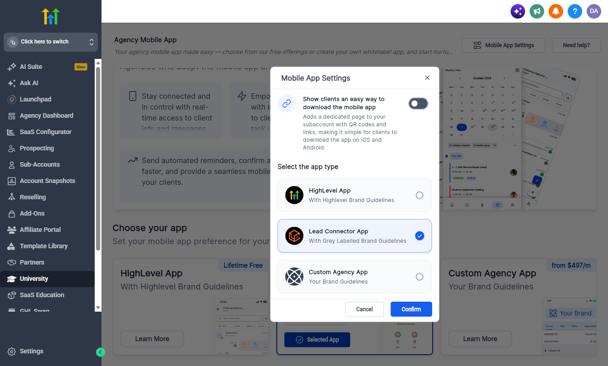

*The Mobile App Settings dialog, before Cancel.*

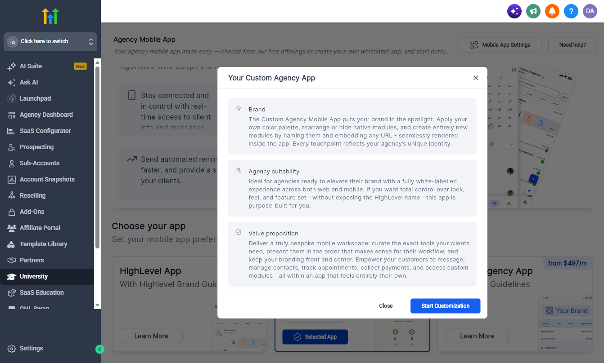

*The Custom Agency App information dialog, before Close.*

### Phone numbers

There are two places.

**Agency, Settings, Phone Integration.** It has three tabs: Agency Settings, Sub Account Settings and Account Creation.

- Agency Settings is headed "Connected to LeadConnector" with "Pay as you go", "Better Cost with Real-time billing", "Increased security" and "Telephony Management", and a strip that reads "A2P and carrier fees are passed through without markup; A2P is not billed for non-LC accounts." Active Phone Numbers shows 0, 30-Day SMS Delivery Rate 0%, Migration In Progress 0 and Call Completion Rate 0%. The Quick Links are Complete A2P verification, Resolve Suspension, Connect to LC Phone and Set Messaging Limits, and the box beside them says "Your sub-accounts have no issues to manage." A Verified Caller ID Settings switch ("Allow calling without buying a phone number") is on. [47, 48]
- Sub Account Settings says "You are rebilling telephone usage (Calls, SMS, Phone No, etc) to your clients" with "Connect your stripe account" and a Connect Stripe button. It lists both sub-accounts with Number Intelligence Disabled, Rebilling Disabled and Managed By "Not available". It also has Export, Move Numbers and "Switch all sub-accounts to Lc Phone" buttons. None were pressed. [46]
- Account Creation holds default preferences for new sub-accounts as tick boxes: Automatically Link Phone System (ticked and greyed out), Allow Sub-Account Users to submit A2P Registration if re-billing is disabled, Automatically Enable Number Intelligence, Call Recording and Call Transcription, plus a Messaging Limit part. None were changed. [49]

**Sub-account, Settings, Phone System.** The Phone numbers tab is headed "Manage Numbers" ("Manage your Phone Numbers and their configuration here") and the body says:

> Your phone system requires configuration
> Please reach out to our support team for assistance.

with one button, Phone System Settings. [56] The button was pressed once to read where it goes. It opened the agency Phone Integration page on its Sub Account Settings tab again and nothing else, so the sub-account has no Buy number control to read. This agrees with the SMS result on the earlier page, where the platform refused a message with `Trial mode not enabled for this agency`. No number was searched for, bought or ported, and Stripe was not connected.

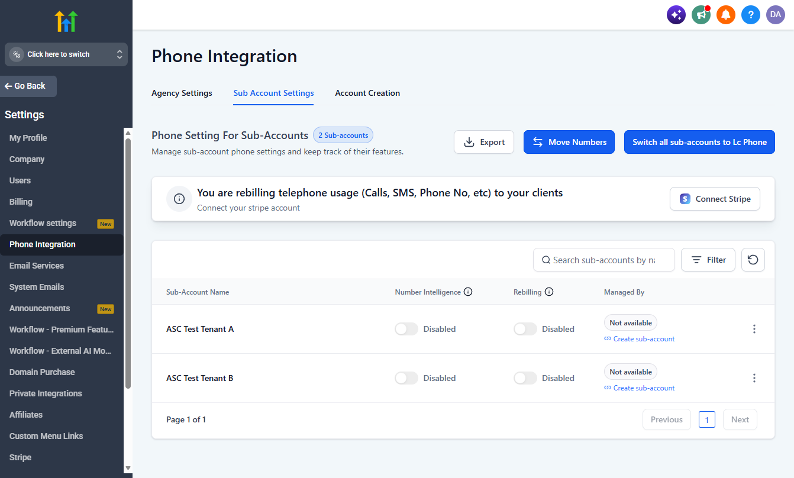

*Phone Integration, Sub Account Settings tab.*

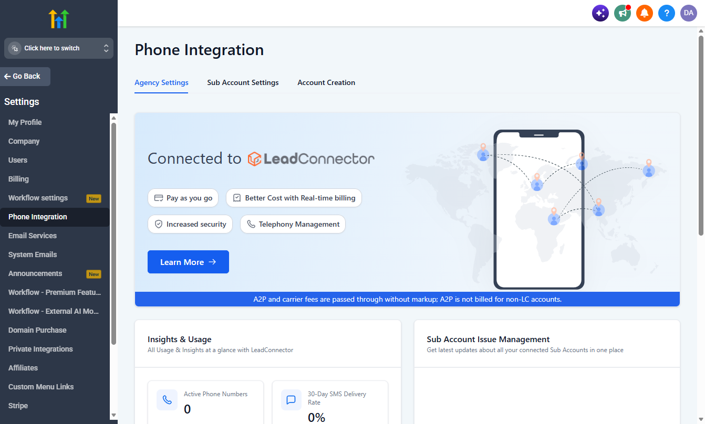

*Phone Integration, Agency Settings tab.*

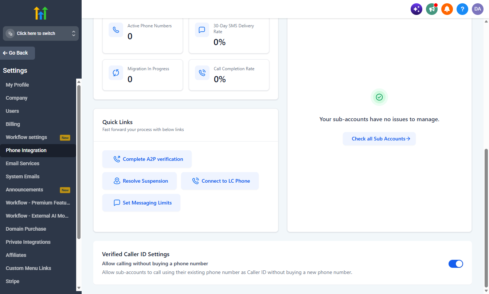

*The lower half of the Agency Settings tab.*

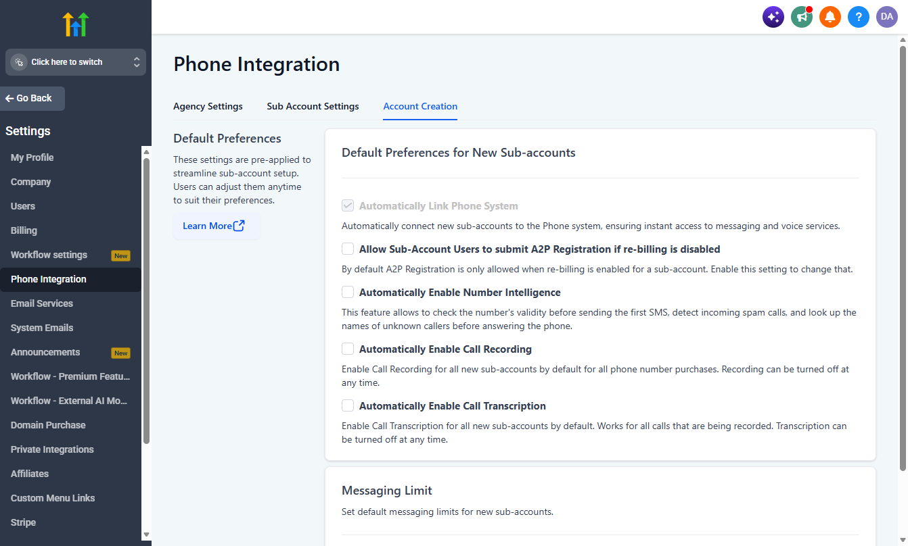

*Phone Integration, Account Creation tab.*

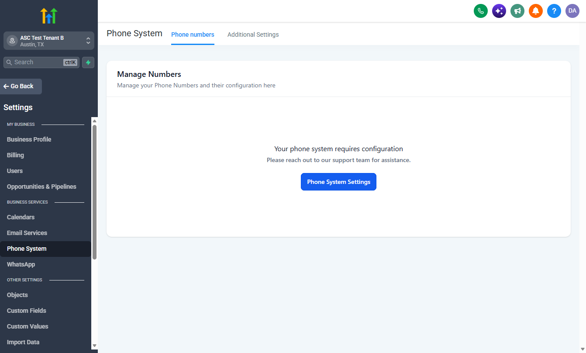

*The sub-account Phone System page.*

## What went wrong, and the fix

- **The browser was signed out.** The saved browser session for the sandbox had expired and the sandbox sign in page showed. The login was repeated the way the account asks for it: email and password, then the six digit code HighLevel emails to the account's own mailbox, which was read from that mailbox and typed in. No human check appeared and none was touched.
- **The API refused the first call.** A plain script call to the snapshots endpoint answered HTTP 403 with a Cloudflare page ("Error 1010: Access denied", "browser_signature_banned"). The same call with a normal HTTP client name in the User-Agent header answered 200. The fix was the header. The token was not at fault.
- **The asset search looks inside the types.** Typing `forms` in the picker's search box gave "No assets found". The search matches the names of the items, not the names of the types, so `Course`, `Spreadsheet` and `Lead` were used and each showed the types holding a match. Ticks made under one search stayed ticked under the next.
- **The list showed five rows after the search was cleared.** The picker drew only five of the 62 types after the box was emptied. The ticks were still there, and the contents dialog afterwards confirmed it, so Create was pressed.
## Limits, with what was not done

- **Sandbox only.** Everything is in the free developer sandbox `DAC Dev Sandbox` with invented data. The sandbox expires up to 6 months after creation and its data can be reset, so the snapshot may disappear with it.
- **The snapshot was not shared, loaded or sold.** No share link was made, Copy snapshot ID was not pressed, the plus (load into a sub-account) and upload icons were not pressed, nothing was put on the marketplace, and the snapshot was not imported into another account. The sandbox allows two sub-accounts and both are in use, so loading it somewhere to prove the restore was not tried either. That a snapshot restores the kit is not shown here, only that it exists and holds the eleven assets.
- **The snapshot is not everything.** The picker offered 62 asset types. Custom fields (43), custom values (1), calendars (2), the second certificate, a dashboard, a knowledge base, review settings and a contact detail view were not included.
- **Read only means read only.** Nothing was saved, purchased or started on any settings page. No brand, domain, logo or policy was entered. Enable SSO and Start Customization were not pressed. No app was selected or confirmed. No phone number was searched for, bought or ported, no card was entered, no trial was started and Stripe was not connected. The Mobile App Settings dialog and the two Phone Integration lists were opened and left as found.
- **Not opened.** The Advanced Settings tab of Company, the Learn More buttons on the HighLevel App and Lead Connector App cards, the Learn More links on the SSO and Phone Integration pages, the snapshot's View history and Settings entries, and the Version history tab of the contents dialog.
- **No claim of availability beyond the page.** The white label and single sign on pages carried no plan gate text, which is not the same as the features working here. The white label domain boxes and the SSO setup were not tried. The only price on any of the pages is `from $497/m` on the Custom Agency App.
