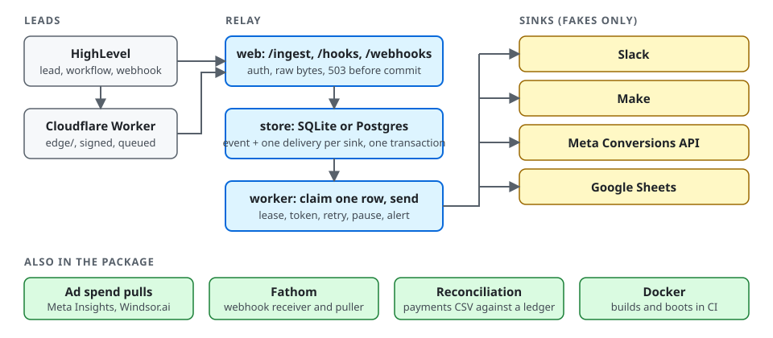

# relay



A Python and Flask service that takes a HighLevel lead delivery and fans it out to the sinks a tenant enabled (Slack, Make, Meta Conversions API, Google Sheets). It also pulls daily ad spend from Meta Insights and Windsor.ai, receives and pulls Fathom meetings, and reconciles a payments CSV against a ledger.

No real vendor account was used for any vendor except one check of the Google Sheets values calls with a user token (see the register). Every vendor is a local fake written from a saved copy of the vendor's own documentation, so this page claims what the fakes and the tests show and nothing more. Delivery is at least once with a stored outcome per event and sink, and an idempotent effect only where the vendor offers one. It is NOT exactly once: Slack and Make document no idempotency key, so a send that ends in a 5xx or a timeout may post twice (its six tries span 4.5 hours or more), and the Slack footer carries the first 8 characters of the event id so a duplicate is recognisable. A sink can instead be told to hold such a send with `hold_unresolved: true` (off by default): an ambiguous answer, or a row whose earlier try may have posted because the worker died before its final write, is stored dead with a `held:` reason and an alert, and nothing sends it again until an operator has looked at the destination and replays it (runbook, "A held send"). Its tests are in `tests/test_hold_unresolved.py` and run on SQLite and Postgres; no real Slack or Make account was used.

**At a glance** (details and dates under Counts): 2922 tests pass on SQLite and Postgres 17 (a full local run on 2026-10-24, in two parts), 669 mutants each break one guard (the 77 added on 2026-10-24 for the history import, the Windows service and the health check and the 15 added later that day for the per-user task were all caught, 26 of them only on Windows) with a named failing test each, and a container smoke test sends one lead through the built image to a fake Slack.

## Register

Each row says what ran against a fake and what never ran against a real vendor. Fixtures are tagged `doc` or `observed` in `contracts/<vendor>/SOURCE.md`, and only Google has `observed` ones. `python tools/check_readme_claims.py` fails when this page calls a doc only integration verified or live, and CI runs it.

| integration | what ran | what did not | provenance |
|---|---|---|---|
| Slack | The sink against a fake with chaos modes (rate limit, 5xx, 5xx after the message was posted, hang, forbidden, revoked hook, odd 200). Escaping, a cut to 2800 characters after escaping, header and block limits, the footer. The Fathom meeting message goes through the same sink. | No real Slack workspace, no real delivery. Which status accompanies each error name is ASSUMED (the page that lists it was not retrieved). | doc: docs.slack.dev pages retrieved 2026-10-22, see `contracts/slack/SOURCE.md`. |
| Make | The sink against a fake: any 2xx is queued, queue full retries, 429 retries, 410 and 403 pause the sink, 5xx and timeouts are ambiguous, the optional api key header. | No real Make account. Whether a scenario can deduplicate on the relay's `Idempotency-Key` header was not tested. The status for a wrong api key and the 5 MB ceiling are ASSUMED. | doc: help.make.com/webhooks and apps.make.com/gateway retrieved 2026-10-22, see `contracts/make/SOURCE.md`. |
| Meta Conversions API | The sink against a fake that refuses what Meta's pages forbid: an unhashed email or phone, a hashed fbc, an event_time that is not an integer or is over 7 days old, a missing action_source, a website event with no user agent. The hash vectors printed on Meta's page, fbc in milliseconds, UTM and URL sanitising, skip, dead, pause and throttle paths, and a seeded property test. A lead needs a click id unless `capi_require_click_id` is false, and a workflow body needs a `type` such as `Lead`: without it the delivery is skipped with an alert (docs/routes.md). | No real Pixel, token or Events Manager. The body of a success and the status of each error code are ASSUMED. `test_event_code` is not a sandbox: those events still reach Events Manager. For two server copies the page gives no dedupe window. The page side half of deduplication is not built. | doc: developers.facebook.com pages retrieved 2026-10-22, see `contracts/meta/SOURCE.md`. |
| Google Sheets | The sink against a fake that verifies the service account JWT signature with the public key and the append rules: RAW keeps `=1+2` as text, a table found by adjacent cells, a row at the table's first column, and an append that searches column A so a column empty in every row cannot split the table. One append in flight per spreadsheet, a read-back before a retry, one row after a crash and after a late landing append. On 2026-10-23 the append and read-back calls were also run once against the real Sheets API with a user OAuth token on a scratch spreadsheet (trashed the same day). It showed the bare `Sheet1` scattering rows when a column is empty, a cell limit counted in UTF-16 units, a 429 with no `Retry-After` that cleared after 48 seconds, and the 400, 401 and 404 texts. The fake and the sink were corrected to match. | No real service account sign-in: the signed JWT never went to Google, and the relay's own HTTP client never ran against real Google. A private sheet not shared with the account (403) and a 401 healed by a refreshed token are ASSUMED, as is how Sheets orders concurrent appends. Base64url and RS256 rest on RFC 7515 and 7518, which were not retrieved. | doc: developers.google.com pages and RFC 7523 retrieved 2026-10-22. Observed 2026-10-23 with a user token, not a service account: `contracts/google/*.observed.json`, see `contracts/google/SOURCE.md`. |
| Meta Insights | The pull against a fake that serves string spend in pages, an empty page that still carries next, error 190, throttle codes with the usage header in minutes, and error 100 subcode 1487534. Decimal to integer minor units with an ISO 4217 table, a 28 day re-pull upserted on the primary key, all or nothing writes, a next link to another host refused. | No real ad account or token. That spend is in `account_currency` is the likely reading and Meta does not state it (ASSUMED). The ISO 4217 table was written from the standard and not retrieved (ASSUMED), and so is the status of each error code. | doc: developers.facebook.com pages retrieved 2026-10-22, see `contracts/meta/SOURCE.md`. |
| Windsor.ai | The pull against a fake that takes the key only as a query parameter, serves spend as a JSON number and answers 429 with and without `Retry-After`. Spend goes through `Decimal(str(x))`. A test proves the key reaches no log line, exception message or database column. | No real Windsor account. The page names no header for the 429 reset, so `Retry-After` is ASSUMED, and so is the currency of `spend`. | doc: windsor.ai/api-documentation retrieved 2026-10-22, see `contracts/windsor/SOURCE.md`. |
| Fathom | The receiver against signatures built by code that does not import the relay: raw bytes, every `v1` entry in constant time, a 5 minute window both ways, dedupe on `webhook-id`, the meeting stored in its event's transaction, a 2 MB cap, optional Slack fan out. The puller against a fake with `next_cursor`, 429 with `Retry-After` and a limiter of 60 calls per 60 seconds (30 for heavy calls). | No real Fathom webhook was received, so no real signature was checked: the page's example signature cannot be reproduced because the page does not print its body. The retry schedule is unpublished, so nothing beyond a repeated `webhook-id` is ASSUMED about retries. | doc: developers.fathom.ai pages retrieved 2026-10-22, see `contracts/fathom/SOURCE.md`. |
| Reconciliation | A pure function and a CSV loader with a column map that reads UTF-8 (with or without a byte order mark) and Windows-1252 and names the file and byte offset of anything else. Property tests for shuffled rows, repeated rows, split payments, rounding and a currency mismatch. Amounts are decimal strings turned into minor units, a float or an unknown currency is refused. | No real payments export. The loader takes any CSV and no payment provider's column names appear in the package. | Written for this repo from no vendor page, so there is no fixture. |
| Docker | The `Dockerfile` (python:3.13-slim, non root, a shell wrapped gunicorn command so `PORT` expands, `/tmp` declared a `VOLUME` so a mounted task volume keeps its mode 1777). CI builds the image and `tools/container_smoke.py` boots it on a read only root with tmpfs `/tmp` and `/data`, checks `/health` and the user, sends one lead to a fake Slack inside the container and checks a repeat posts nothing more. | No orchestrated deployment. | The CI run on the repository's Actions page. |
| Railway | Nothing. It is not deployed to Railway, and there is deliberately no `railway.toml` and no Procfile. | A deploy, a healthcheck probe, a cron service. | Railway pages saved 2026-10-22, see the Railway notes in [docs/runbook.md](docs/runbook.md). |

Also true of every row: no real HighLevel delivery has reached this service. `POST /webhooks/ghl` checks an Ed25519 signature that is tested with keys generated in the test and never with HighLevel's own private key.

## How it works

- `relay/store/`: SQLite and Postgres with the same semantics. Idempotency is a primary key. A claim is one `UPDATE ... RETURNING` with a lease on the database clock (`FOR UPDATE SKIP LOCKED` on Postgres), and the final write only lands when the claim token still matches. State, attempts row, flow control and alerts are one transaction.
- `relay/app.py`: the routes. A failure before the durable commit is a 503, never a 200. The request path only stores.
- `relay/worker.py`: `python -m relay.worker`, `--once` (drain and exit) and `--purge` (null payloads older than 30 days, the row stays so dedupe holds). One thread per sink, a timeout per sink, minimum intervals kept as a time in the database and not a sleep, and a circuit breaker.
- `relay/sinks/`: Slack, Make, Meta Conversions API, Google Sheets. `relay/pulls/`: Meta Insights, Windsor.ai and Fathom pulls, `python -m relay.pulls`. `relay/fathom_hook.py`, `relay/reconcile.py`, `relay/money.py`.
- `relay/import_history.py`: `python -m relay.import_history <file.csv>` loads prior outbound contacts or a do-not-contact list (dry run unless `--apply`, all or nothing, idempotent); a suppressed contact is refused at send time and the reason is stored. [docs/history-import.md](docs/history-import.md).
- `deploy/windows/`: registers the worker as a Windows scheduled task that restarts itself, with `-WhatIf` to print the task and register nothing, and `-RunAs CurrentUser` for a per-user task that needs no elevation. On 2026-10-24, on one Windows 11 machine, that per-user task was registered and Task Scheduler restarted a killed worker (`python tools/task_scheduler_check.py`); the SYSTEM account was not run. [docs/runbook.md](docs/runbook.md).
- `tools/demo_cutover.py`: one script that runs the whole move from an old system (history import, replayed leads, a killed worker, a health alert) and asserts each step; [docs/demo.md](docs/demo.md) has the replay and the numbers.
- `relay/health_check.py`: `python -m relay.health_check` exits non-zero when the worker heartbeat is stale or the oldest unfinished delivery is too old, and `--alert` posts one Slack alert per cooldown. [docs/runbook.md](docs/runbook.md).
- Routes, duplicates and outcomes: [docs/routes.md](docs/routes.md). Configuration: [docs/configuration.md](docs/configuration.md). Runbook, retention, scheduling, reconciliation and the Railway notes: [docs/runbook.md](docs/runbook.md).

## Run it

```
cd relay
python -m venv .venv
.venv/Scripts/python -m pip install -r requirements-dev.txt     # or .venv/bin/python on Linux and macOS
docker run -d --name relay-pg -e POSTGRES_PASSWORD=pw -p 55432:5432 postgres:17
DATABASE_URL_TEST=postgresql://postgres:pw@127.0.0.1:55432/postgres python -m pytest -q
DATABASE_URL_TEST=postgresql://postgres:pw@127.0.0.1:55432/postgres python tests/mutants.py
python tools/check_readme_claims.py
python tools/check_readme_counts.py
python tools/container_smoke.py --build
docker rm -f relay-pg
```

The three commands the worker's operators use besides `relay.worker` (the history import is a dry run until `--apply`):

```
python -m relay.import_history history.csv --kind ContactCreate [--apply]
python -m relay.import_history dnc.csv --list suppression [--apply]
python -m relay.health_check [--alert]
powershell -ExecutionPolicy Bypass -File deploy/windows/install-service.ps1 -WhatIf
```

On Windows PowerShell the two `DATABASE_URL_TEST=... python` lines are not valid, so set the variable first and call the venv Python explicitly:

```
$env:DATABASE_URL_TEST = "postgresql://postgres:pw@127.0.0.1:55432/postgres"
.venv\Scripts\python.exe -m pytest -q
.venv\Scripts\python.exe tests\mutants.py
```

Without `DATABASE_URL_TEST` the Postgres half is skipped and the run prints that it skipped. CI sets `RELAY_REQUIRE_POSTGRES=1`, which turns the skip into a failure. The mutation harness copies the package, breaks one guard per mutant, and counts it caught only when a named test fails for the mutated behaviour and that same test passes on the unmutated copy. A tree that no longer imports, a fixture error or a missing test file is reported as BROKEN, not caught. `--shard i/n` runs every n-th mutant, which is how CI splits the list.

## Counts

From one full local run on 2026-10-24: 2922 tests passed and 2 skipped on SQLite and on Postgres 17, on Windows 11, with `RELAY_REQUIRE_POSTGRES=1` set. The run is two `pytest` invocations over disjoint lists of test files because one pass is longer than this machine's 10 minute command limit: 12 files gave 1343 passed in 12 minutes 44 seconds, and the other 31 files gave 1578 passed, 2 skipped and 1 failed in 8 minutes 6 seconds. The failure was the check that the README counts match the files, run before this section was updated; after the update `tests/test_tools.py` and `tests/test_repo_hygiene.py` were run again and the check passed, which makes 1343 + 1578 + 1 = 2922 (pytest counts each store backed test once per store; the 2 skips are the Postgres row lock test and the SQLite lock expiry test, which have no counterpart on the other store). The 45 test files hold 2180 lines whose first word is `assert` (a static count with indented lines, not executed assertions). The 44th file, `tests/test_demo_cutover.py`, was added after the full run and was run on its own on 2026-10-24: it passed in 31 seconds. The 45th file, `tests/test_hold_unresolved.py`, was added on 2026-10-25 and also falls outside the full run above.

`python tests/mutants.py` holds 669 mutants: 111 from tier 1, 190 from tier 2, 215 from tier 3, 17 from the first output pass, 20 from the second, 17 from the Sheets check and backoff cap, 2 from the infrastructure review (a database free `/livez` route and a container smoke test that runs with a read only root), 77 from the history import, the Windows service and the health check (13 for contact keys, 25 for the import and the send time check, 5 for the lease floor, the region and the Slack alert text, 18 for the heartbeat and the health check, 5 for the alert cooldown and 11 for the install script, which run only on Windows and are listed as not run elsewhere) 15 from the per-user mode of the install script (also Windows only) and 5 from the `hold_unresolved` option, which were run on their own on 2026-10-25 (`--only "hold:"`, `--no-baseline`) and all 5 were caught by a named failing test; the first run of the first 4 caught 3, and the survivor showed that the test for a sink that can read back never made a second try, which `test_a_sink_that_can_read_back_is_looked_up_again_on_the_next_try_not_held` now does. The 15 for the per-user mode were run on 2026-10-24 together with the other 11 Windows mutants (`--only "windows: "`, `--no-baseline`, two shards): all 26 were caught by a named failing test. On 2026-10-23 all 8 local shards, `--shard 1/8` to `8/8` with `--no-baseline`, ran and every one of the 570 then in the file was caught by a named failing test; the 2 added on 2026-10-24 were run on their own with `--only` and both were caught. The 77 added later on 2026-10-24 were run on their own the same way and all 77 were caught; that run also showed two tests of mine that were flaky or vacuous (a freshly written heartbeat can read a hair under zero seconds old, and an empty working directory resolves to the test's own folder), which were fixed and their mutants run again. The other 572 earlier mutants were not all run again: every mutant that edits a file this change touched (`store/base.py`, `fanout.py`, `worker.py`, `sinks/slack.py`, `sinks/base.py` and `config.py`, 159 in all, old and new) was run on 2026-10-24 and all 159 were caught. The harness's baseline step hit its 420 second limit here, so the full suite run above stood in for it. CI runs the same list in 8 shards. The container smoke test passed earlier on 2026-10-24 (before the history import, the Windows service and the health check were added, and not run again since), now with `--read-only`, a `/tmp` and `/data` tmpfs and `HOME=/tmp`, the read only root of the Fargate task in `../infra/`, with a tmpfs standing in for its `/tmp` volume. `tests/corpus/` keeps the 60 cases an independent reviewer wrote, and `tests/test_output_corpus.py` replays the eight that disagreed. These numbers are the relay's own and are kept apart from the 324 assertions of the root suites and the counts in `edge/README.md`.

## ASSUMED, and what would settle each

- HighLevel: whether its Ed25519 signature is over the raw bytes or over `JSON.stringify(body)` (the relay accepts either), whether a delivery carries a `webhookId` and is flat or wrapped in `data`. One real delivery settles all three. `X-WH-Signature` was announced for deprecation on 2026-09-01 and its removal was not observed.
- Slack and Make: the status for each Slack error name and for a wrong Make api key, and the Make 5 MB ceiling. One real call each.
- Meta: the body of a success (any 2xx is done), the status of each error code, a bare 11 to 15 digit phone already carrying a country code, `OpportunityStatusUpdate` with `status: "won"` as the Purchase, that Insights `spend` is in `account_currency`, and the ISO 4217 table. One real call each, and one account in a non USD currency for the last two.
- Google: the service account sign-in, what a private sheet not shared with the account answers, how long a slow append takes to land (the relay waits 60 seconds before it believes an empty read-back), and how concurrent appends are ordered.
- Windsor.ai: that a 429 carries `Retry-After`, and the currency of `spend`.
- Fathom: nothing about retries beyond "the same `webhook-id` comes again". One real webhook settles the signature check.
- Versions: Python 3.13, `python:3.13-slim`, `psycopg[binary]` and `cryptography`'s Ed25519 API were checked at install time on 2026-10-22: every pinned version was at least 14 days old on PyPI (Flask 3.1.3, gunicorn 26.2.0, httpx 0.28.1, cryptography 50.0.2, psycopg 3.3.6, pytest 9.1.1).

## Known limits

- The outer repeat of the claimable predicate in the Postgres claim is belt and braces: under READ COMMITTED with `SKIP LOCKED` removing it changes no behaviour, so it has no mutant.
- The 500 lead test and the seeded property tests use simulated database time, so they prove the logic and not wall clock throughput.
- Two payments with the same id, amount, currency, date and bucket cannot be told from a repeated row, so reconciliation reports them as a duplicate.
- A pull writes all or nothing, so one malformed row in a window stops that window until the row or the code is fixed.
- A replay is a deliberate re-send: replaying a Sheets row that already landed appends it again.
- A transcript is never stored by the relay, but the Fathom body is read in memory up to the route's cap.

## License

MIT, see [LICENSE](LICENSE).
