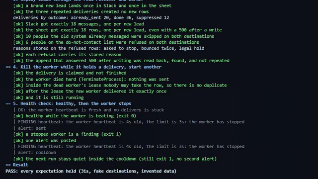

# Cutover demo

Back to the [relay README](../README.md).



*A replay of one real run of `python tools/demo_cutover.py`, captured 2026-10-24. The output is the script's own, played back at a readable speed. [Full quality mp4](demo.mp4).*

One script walks the move from an old system to this relay and asserts every step. It uses the real import, receiver, worker and health check, against the suite's own fake Slack and fake Google Sheets, with invented people. It is also a test (`tests/test_demo_cutover.py`).

## Run it

```
cd relay
python tools/demo_cutover.py
```

It needs the relay's dev requirements (`pip install -r requirements-dev.txt`), no database server (it makes a temporary SQLite file) and no accounts. It takes about 30 seconds and exits non-zero when any step fails.

## What it shows

1. **The old export.** A Windows-1252 CSV of 315 rows: phone numbers written four ways, upper case emails, 12 repeats and 3 rows that are not contacts. Next to it, a do-not-contact list of 25 rows, 5 of them also in the history file.
2. **The import.** The list goes in first. The history import runs as a dry run (300 would be written, 12 repeats, 3 refused rows named by line number and never by contact, 5 of the history people on the do-not-contact list). `--apply` refuses the file while refused rows remain, `--skip-invalid` writes the 300 distinct people, and importing the same file again writes nothing.
3. **Leads replayed.** 18 new people, 10 the old system had already messaged, 6 on the do-not-contact list, and three repeated deliveries. Slack received 18 messages and the sheet 18 rows. The 10 already messaged people and the 6 refused people were skipped on both destinations, each refusal carrying its stored reason. One append was written and then answered with a 500: the relay read the sheet back, found the row and did not append again.
4. **A worker killed mid send.** The worker is killed hard (TerminateProcess) while it holds a delivery that the fake Slack is holding open. A second worker starts. Inside the dead worker's lease nothing is sent. After the lease the delivery goes out once. The fake Slack was still holding the request open when the worker was killed, so the provider had not accepted it: this shows recovery of an unsent claim. A request the provider accepted and then lost the acknowledgment for is sent again on Slack and Make (see the README), and only the Sheets destination reads back before it retries.
5. **Monitoring.** The health check reports healthy while the worker beats. With the worker stopped it exits 1 on the stale heartbeat and posts one alert. The next run, inside the cooldown, still exits 1 and posts nothing.

## The numbers from the run on 2026-10-24

| Step | Result |
|---|---|
| History file | 315 rows read, 300 written, 12 repeats folded, 3 refused |
| Do-not-contact file | 25 rows written |
| New leads | 18 in Slack, 18 rows in the sheet |
| Already messaged | 10 people, 20 deliveries skipped |
| On the do-not-contact list | 6 people, 12 deliveries refused with a stored reason |
| Append answered 500 after writing | 1, read back and found, not repeated |
| Worker killed mid send | 0 sends inside the lease, 1 after it |
| Health check | exit 0 while beating, exit 1 when stopped, 1 alert, 0 inside the cooldown |

Removing the send time contact check makes the script fail on four steps (the Slack and sheet counts and both skip counts), which is how it was checked to be a test and not a replay.

## Limits

- The destinations are the suite's fakes, written from each vendor's documentation. No real Slack workspace or Google account was used.
- The people are invented. The import has never been run on real records.
- It runs on SQLite. The same code paths run on Postgres in the test suite, not in this script.
- It kills and restarts the worker itself. The Task Scheduler restart is covered in the [runbook](runbook.md).
- Nothing here is deployed.
